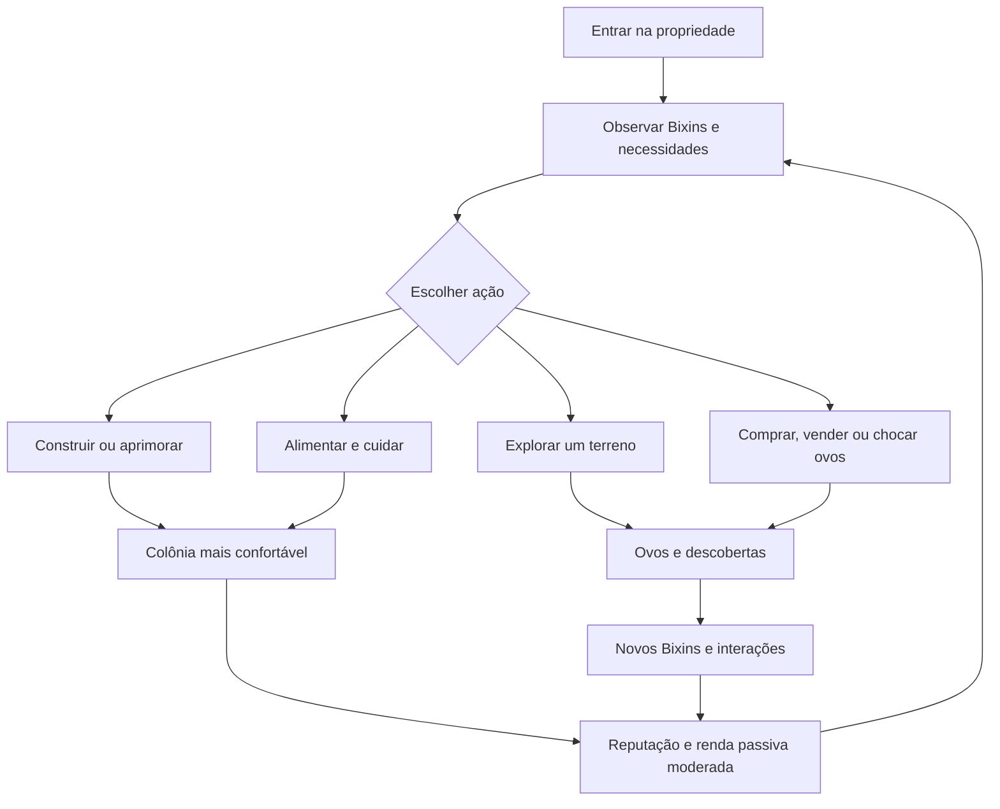
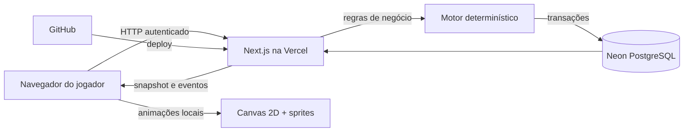

# BIXINS 🥚🌿

> **Documento mestre de game design, direção de arte e implementação**  
> Versão: **1.0 — concepção para desenvolvimento**  
> Idioma: **Português brasileiro (pt-BR)**  
> Plataformas: **navegador (desktop e celular)**  
> Stack de referência: **GitHub + Next.js/TypeScript na Vercel + PostgreSQL no Neon**  
> Orçamento de infraestrutura da primeira versão: **R$ 0, sujeito aos limites dos serviços gratuitos**  
> Estilo: **simulador de vida + Tamagotchi + idle game + gestão de propriedade/colônia**  
> Identidade: **brasileira, autoral, extremamente fofa, colorida e rica em ilustrações**

---

## 0. Instrução central para o Codex

**Criar BIXINS como um jogo web funcional, persistente e visualmente caprichado; não como uma página estática de apresentação.** Este documento contém a visão do produto, parâmetros iniciais de balanceamento e um roteiro técnico. Onde houver escolhas em aberto, usar os valores definidos aqui como padrão **configurável**, registrar a decisão no projeto e priorizar o MVP indicado na seção 25.

1. **Não descartar requisitos por conveniência.** Se algo pertencer a uma fase posterior, preparar modelo de dados e interfaces para expansão, mas não implementar sistemas incompletos como se já estivessem operacionais.
2. **Não tentar implementar tudo em uma única mudança.** Trabalhar por etapas pequenas e demonstráveis, com testes e commits lógicos.
3. **Tudo que altera dinheiro, ovos, Bixins, estruturas e reprodução deve ser validado no servidor e salvo no Neon.** O navegador nunca é a autoridade econômica.
4. **A fazenda deve ser realmente visual:** terreno ilustrado, cerca, vegetação, objetos com sprites, personagens animados e feedback de ações. Evitar um dashboard de cartões fingindo ser o jogo.
5. **A experiência deve começar jogável** sem pagamento, APIs de IA generativa ou serviços extras obrigatórios.
6. **Não utilizar arte, criaturas, nomes ou sprites protegidos de Tamagotchi, Pokémon, Digimon etc.** Criar um universo próprio.
7. **Não simular venda/captura de animais silvestres reais brasileiros.** As criaturas são seres fantásticos; a exploração encontra ovos de Bixins fictícios, não incentiva tráfico de fauna real.
8. Não depender de manter um processo 24/7 para cada usuário. Utilizar **simulação por tempo decorrido** + animação local em tempo real.
9. Mostrar um estado honesto para ações assíncronas: carregando, sucesso, erro e sincronização; nunca exibir moeda ou itens confirmados antes da resposta do servidor.

---

# PARTE I — VISÃO DE JOGO

## 1. Conceito

**BIXINS** é um jogo brasileiro de navegador em que cada jogador recebe uma **propriedade cercada, inicialmente vazia**, e a transforma num habitat bonito, funcional e cheio de pequenas criaturas fantásticas chamadas **Bixins**.

Os Bixins começam como **ovos**, nascem, crescem, envelhecem, movem-se livremente pelo terreno, apresentam necessidades físicas e emocionais, possuem temperamentos diferentes, usam os objetos instalados e **interagem uns com os outros sem depender de ordens diretas**.

O jogador administra simultaneamente:

- **A colônia:** alimentação, água, saúde, higiene, descanso, brincadeiras, relações e reprodução.
- **O ambiente:** construção, decoração, organização de espaços, capacidade e conforto do recinto.
- **A coleção:** espécies, variantes de cores, raridades, linhagens e descobertas.
- **A economia:** créditos fictícios (`C$`), aquisição e venda de Bixins, compra de estruturas, melhorias e expedições.
- **A exploração:** viagens temáticas para ambientes brasileiros com espécies distintas.

A graça não é apenas manter barras cheias: é **observar a vida que emerge da combinação de personagens, personalidades, estruturas e eventos**.

### 1.1 Frase de apresentação

> *Um terreninho, muitos ovinhos e um mundão de Bixins para cuidar.*

### 1.2 Fantasia do jogador

> "Este é meu cantinho. Cada Bixin aqui tem uma história, um jeito e uma relação com os outros. O lugar fica melhor porque eu cuido dele — mas nunca controlo tudo."

### 1.3 Pilares

| Pilar | Significado prático |
|---|---|
| **Vida própria** | Bixins tomam pequenas decisões e possuem rotinas observáveis. |
| **Carinho sem obrigação** | Cuidar é recompensador, mas ausências não devem punir brutalmente. |
| **Gestão espacial** | Posição, quantidade e tipo de objetos afetam o funcionamento da colônia. |
| **Coleção brasileira** | Ecossistemas, paletas e nomes dialogam com a diversidade ambiental do Brasil. |
| **Descobertas emergentes** | Temperamentos, amizades, conflitos e genética criam histórias diferentes. |
| **Progressão acessível** | Começar simples; aprofundar a gestão aos poucos. |
| **Beleza viva** | A fazenda deve ser o centro da interface: uma ilustração que se movimenta. |

### 1.4 O que BIXINS não deve ser

- Não é um clicker sem fim que exige clicar para produzir C$.
- Não é um clone de Pokémon com batalhas como atividade principal.
- Não é uma interface só com números, tabelas e retratos estáticos.
- Não é um simulador realista de comércio/captura de animais silvestres.
- Não é um jogo que exige conexão constante, presença noturna ou pagamento.
- Não precisa de um modelo de IA por criatura: comportamentos **baseados em regras** são mais baratos, testáveis e coerentes.

## 2. Loop de jogo



**Sessão curta (2–5 min):** abrir o recinto, observar acontecimentos, reabastecer, cuidar de um Bixin, recolher recompensas e sair.  
**Sessão média (10–20 min):** reorganizar objetos, planejar melhorias, realizar expedição, comparar Bixins e escolher novos ovos.  
**Sessão longa (30+ min):** personalizar a propriedade, estudar linhagens, completar a Bixinpédia e observar eventos sociais.

## 3. Começo de jogo e onboarding

**Premissa obrigatória:** o terreno começa realmente vazio de objetos e sem Bixins caminhando. Só existem cerca, entrada e paisagem natural. O kit de boas-vindas aparece **no inventário/caixa de entregas**, não instalado automaticamente.

**Recursos iniciais sugeridos:**

- Saldo: **C$ 600**.
- 1 **Ovo Inicial** de espécie comum aleatória entre espécies iniciais habilitadas.
- 1 comedouro básico, 1 bebedouro básico, 1 caminha de palha e 1 brinquedo de corda **gratuitos**, no inventário.
- A primeira incubação pode ocorrer numa **área de ninho temporária gratuita** incluída na ferramenta de adoção, sem exigir construção de incubadora paga.
- Ração inicial para 24 horas de jogo, usando o ritmo configurado neste documento; água básica grátis.
- Primeiro terreno de tamanho **20 × 14 células**, com limite de **6 Bixins ativos**.

**Tutorial em até 7 passos, opcional e pulável:**

1. Mostrar terreno vazio e a mensagem: "Esse pedacinho de mundo agora é seu!".
2. Abrir caixa de entregas e selecionar o ovo.
3. Colocar o ninho temporário no terreno e iniciar incubação.
4. Posicionar comedouro, bebedouro, caminha e brinquedo com prévia visual.
5. Ensinar a mover a câmera e tocar nos objetos.
6. Após a incubação, mostrar e batizar o primeiro Bixin (com opção de nome automático).
7. Abrir o painel do Bixin e acompanhar sua primeira ação autônoma.

**Sem bloqueios no início:** se o jogador gastar todo o saldo, ele ainda consegue alimentar, hidratar e proteger seus Bixins com os recursos básicos; não pode ficar preso numa condição sem recuperação.

---

# PARTE II — MUNDO, CRIATURAS E COMPORTAMENTOS

## 4. A propriedade

### 4.1 Representação visual

- Área principal em **2D, visão levemente elevada (3/4) com sprites ilustrados**; nada de 3D pesado no MVP.
- Grade lógica de **20 × 14** para colisões e construções, mas os traços da grade só aparecem no modo de edição.
- Cerca ilustrada ao redor de todo o limite, portão frontal e cenário externo decorativo.
- Chão gramado com variação de textura; pequenos tufos, folhas, pedras e flores em camadas.
- Câmera com **arrastar, zoom moderado, centralizar** e limites para não mostrar áreas inexistentes.
- Objetos com sombras suaves, partículas, microanimações e pequenas reações ao uso.
- Bixins circulam livremente entre pontos alcançáveis; os objetos devem permitir aproximação e interação.
- A área deve funcionar bem em **mobile first**, com gestos e controles grandes, mas oferecer boa visão panorâmica no desktop.

### 4.2 Edição do terreno

- Modo **Construir**: selecionar catálogo → ver silhueta fantasma → posicionar → validar colisão/custo → confirmar.
- Objetos podem ser movidos, girados quando o sprite permitir, guardados, restaurados e removidos.
- Mostrar **verde** para posição válida, **coral** para inválida e uma pequena dica do motivo.
- Não permitir bloquear todos os caminhos entre a entrada e recursos essenciais.
- Usar célula de colisão, área funcional e raio de interação distintos.
- Quando uma construção for movida, Bixins próximos recalculam sua rota.
- Capacidade de uso: alguns objetos comportam um, dois ou vários Bixins simultaneamente.
- Decoração aumenta o charme, mas não substitui recursos básicos.

### 4.3 Expansões

| Nível | Grade | Limite de Bixins ativos | Custo indicativo |
|---|---:|---:|---:|
| Quintal | 20 × 14 | 6 | Inicial |
| Terreninho | 24 × 16 | 10 | C$ 1.800 |
| Sítio | 30 × 20 | 16 | C$ 6.000 |
| Refúgio | 36 × 24 | 24 | C$ 16.000 |
| Colônia | 44 × 28 | 36 | C$ 40.000 |

As expansões devem preservar a coordenada dos objetos já posicionados e aumentar a área livre nas bordas. **MVP:** implementar apenas Quintal e Terreninho; demais definidos para roadmap.

## 5. O que é um Bixin?

Cada Bixin é uma **instância única**, mesmo quando pertence à mesma espécie.

### 5.1 Identidade e informações

| Categoria | Campos |
|---|---|
| Identificação | `id`, espécie, nome dado pelo jogador ou nome automático, data de nascimento, proprietário. |
| Origem | bioma/região descoberta, ovo de origem, método de aquisição, linhagem. |
| Vida | estágio, idade em tempo real, idade exibida em dias Bixin, condição de saúde. |
| Biologia fantástica | sexo/identificação reprodutiva, gênero apresentado, compatibilidade para reprodução, cor/variante. |
| Personalidade | temperamento principal, traços secundários, preferências, aversões. |
| Genética | atributos herdáveis e procedência dos pais, quando existentes. |
| Social | amizades, afinidades, rivalidades leves, parceiros compatíveis, relações familiares. |
| Economia | raridade, valor estimado, histórico de aquisição e transferência. |
| Atividade | posição, ação atual, alvo, tempo da próxima decisão, estado visual. |

**Nomes:** o jogador pode renomear livremente dentro de limites; opção "Me surpreenda" escolhe nomes brasileiros/afetivos como Pingo, Pitoco, Fubá, Dengo, Tico, Fifi, Xodó, Pipoca, Cacau, Zeca, Nena. Evitar nomes ofensivos em elementos públicos.

### 5.2 Ciclo de vida

Cada Bixin **nasce de um ovo**, inclusive se foi adquirido no comércio como novo exemplar. Bixins já adultos podem ser transferidos entre jogadores numa futura fase social; as informações e a idade são preservadas.

| Estágio | Tempo real padrão* | Visual e regras |
|---|---|---|
| **Ovo** | 90 min de incubação | Ovo balança, apresenta rachaduras e precisa de espaço de eclosão. |
| **Filhote** | 0–6 h após nascer | Menor, olhos grandes, interações simples, não reproduz. |
| **Juvenil** | 6–24 h | Mais ativo, aprende preferências, brinca e socializa. |
| **Adulto** | 24–120 h | Pode reproduzir, realizar ações plenas e desenvolver relações. |
| **Veterano** | 120 h em diante | Aparência amadurecida; bônus de experiência social; não morre de velhice no MVP. |

\*Valores de **game design**, editáveis em arquivo de configuração; não são compromissos de tempo final. Exibir também **dias Bixin**, sendo **1 dia Bixin = 4 horas reais**, para dar identidade ao calendário interno.

**Atenção:** envelhecimento deve usar horário verificado pelo servidor e não ser acelerado alterando o relógio do dispositivo.

### 5.3 Gênero, sexo reprodutivo e reprodução

- A ficha exibe **gênero/identificação do Bixin** conforme as opções definidas pelo universo fantástico; isto não precisa alterar capacidades ou valor.
- Internamente, usar `reproductive_role` (`A`, `B` ou `none`) **separado** de `gender_label`, para regras de compatibilidade simples e extensíveis.
- Reprodução exige **dois Bixins adultos, compatíveis, da mesma espécie**, saudáveis, com laço social mínimo e recursos adequados.
- Para o MVP, somente pares `A + B` geram ovos; a interface explica compatibilidade sem moralização.
- O jogador **autoriza preparar um ninho de reprodução**, mas os Bixins só o usam se as condições estiverem satisfeitas. Não existe ação coercitiva instantânea.
- Parentesco: bloquear cruzamento entre pais/filhos e irmãos; futuramente, estender até dois graus de parentesco.
- O ovo registra `mother_id`, `father_id` (ou `parent_a_id`, `parent_b_id` como nomes neutros de coluna).
- Máximo **1 ovo por casal a cada 24 h reais** e limite de **2 ovos pendentes por propriedade** no MVP.
- Reprodução deve parar automaticamente quando não houver capacidade de acolhimento, ninho, espaço ou recursos.

### 5.4 Genética simplificada

Genoma leve, sem biologia realista complexa. Cada Bixin guarda:

- `primary_color`, `secondary_color`, `pattern` (liso, pintado, listrado, manchas, gradiente);
- `body_size_variant` (pequeno, médio, fofucho);
- `ear_type`, `tail_type`, `crest_type` conforme espécie;
- `temperament_bias` e `energy_bias` (pequenos modificadores);
- `special_variant` raro (brilhante/aurora), **cosmético**, sem criar vantagem injusta.

**Regras iniciais:** 45% herda a característica do progenitor A, 45% do B, 10% gera variante válida do conjunto da espécie. Modificadores têm limites. Variante especial pode ocorrer com probabilidade-base de **0,5%**, sendo registrada como evento especial; probabilidades do sistema ficam centralizadas em configuração.

Não misturar espécies no MVP. Hibridização entre espécies compatíveis pode ser explorada em versão posterior, com validação de genealogia e sprites próprios.

## 6. Necessidades e indicadores

A UI mostra valores de **0 a 100**. Para evitar ambiguidade, o banco guarda necessidades positivas (`satiety`, `hydration`, `hygiene`, `energy`, `social`, `fun`, `comfort`, `health`): **100 = bem atendido**, **0 = situação crítica**. Na interface, os rótulos podem incluir "Fome" e "Sede", mas com texto acessível: "Alimentação 80% — pouco faminto" e "Hidratação 65% — com sede moderada".

| Indicador | Cai principalmente com | Recupera com | Consequência se baixo |
|---|---|---|---|
| **Saúde** | necessidades críticas prolongadas, incidentes | descanso, cuidado, estrutura de saúde | menor velocidade, menos disposição; nunca sumiço súbito |
| **Alimentação** | passagem do tempo, esforço | comedouros, ração | busca comida e reduz bem-estar |
| **Hidratação** | tempo, calor, atividade | bebedouros e fontes | interrompe atividades para beber |
| **Energia** | movimentação, brincadeira, treino | camas, sombra, repouso | procura local de descanso |
| **Higiene** | atividades, lama, acidentes | banho, limpeza, cuidado | menos conforto e socialização |
| **Social** | isolamento, temperamento específico | proximidade, brincadeiras coletivas | tristeza ou irritação conforme traço |
| **Lazer** | monotonia, ausência de brinquedos | brinquedos e exploração do recinto | tédio e comportamento repetitivo |
| **Conforto** | calor/frio fictício, aglomeração | abrigo, decoração funcional, sombra | menor eficiência de descanso |

**Valores iniciais por filhote:** alimentação 85; hidratação 85; energia 85; higiene 90; social 70; lazer 80; conforto 80; saúde 100. Pequena aleatoriedade determinística ±5, registrada no banco.

### 6.1 Estado geral

- **Ótimo:** média ponderada ≥ 85, sem indicador abaixo de 40.
- **Bem:** ≥ 65.
- **Atenção:** média abaixo de 65 ou algum indicador abaixo de 30.
- **Crítico:** saúde abaixo de 20 ou alimentação/hidratação abaixo de 10.

**Bem-estar** (para monetização passiva e valor) usa pesos configuráveis: saúde 25%, alimentação 12%, hidratação 12%, energia 12%, higiene 8%, social 10%, lazer 10%, conforto 11%.

### 6.2 Degradação e recuperação

Para manter balanceamento legível, usar **decaimento por hora real**, com variações de espécie/traço/ação. Sugestão inicial sem recursos:

- alimentação −6 pontos/h;
- hidratação −8 pontos/h;
- energia −5 pontos/h se ativo, recuperação ao dormir;
- higiene −2 pontos/h;
- social −2 pontos/h para sociáveis; −0,5 para solitários;
- lazer −3 pontos/h;
- conforto dependente de ambiente, não apenas do tempo;
- saúde só cai quando existe **estado crítico persistente**, no máximo −2 pontos/h.

**Autocuidado:** se o Bixin alcança recurso livre e abastecido, pode comer, beber, dormir ou brincar automaticamente. Um comedouro sem estoque não alimenta; bebedouro básico possui abastecimento gratuito automatizado para evitar aprisionamento econômico. Os números acima são parâmetros preliminares, não equilíbrio final.

### 6.3 Ausência do jogador

- Simulação offline completa por até **72 horas**; a partir daí, entrar em **modo de manutenção gentil**.
- No modo gentil, os Bixins mantêm um piso seguro de saúde; podem demonstrar saudade, desorganização ou necessidades moderadas, mas **não morrem, não desaparecem e não têm penalidades irreversíveis**.
- Se uma necessidade ficar crítica, um serviço fictício de **Proteção Bixin** oferece cuidados mínimos automáticos, com recuperação gradual; nunca gera dívida que impeça o jogador de voltar.
- Exibir uma **linha do tempo resumida** do período ausente, em vez de milhares de mensagens.
- "Pausar minha colônia" pode suspender a simulação por período prolongado, sem benefícios econômicos.

## 7. Personalidade e autonomia

### 7.1 Traços principais

| Traço | Preferências e comportamentos |
|---|---|
| **Solitário** | escolhe cantos tranquilos; precisa menos de interação social. |
| **Sociável** | procura outros Bixins, bancos, rodas e brincadeiras. |
| **Brigão** | disputa brinquedos e provoca pequenas confusões não violentas. |
| **Serelepe** | anda rápido, muda frequentemente de atividade e salta. |
| **Preguiçoso** | prefere camas, sombra e trajetos curtos. |
| **Curioso** | inspeciona objetos novos e visitantes. |
| **Guloso** | visita comedouros com frequência, prefere tipos de ração. |
| **Tímido** | evita aglomerações e aproxima-se gradualmente. |
| **Carinhoso** | procura companhia e aceita cuidado com facilidade. |
| **Teimoso** | às vezes ignora sugestões e insiste numa atividade. |
| **Organizado** | tende a usar áreas de higiene e descanso. |
| **Bagunceiro** | deixa sinais de uso e brinca de maneira caótica. |
| **Corajoso** | explora o limite do terreno e objetos desconhecidos. |
| **Assustadiço** | reage com salto ou fuga temporária a ruídos e eventos. |

Cada Bixin recebe **1 temperamento dominante + 2 traços secundários**. Traços não devem ser totalmente aleatórios se tornarem o indivíduo incompatível com qualquer ambiente.

### 7.2 Decisão autônoma

Usar **máquina de estados finitos + pontuação de utilidade**. Sem LLM.

Estados: `idle`, `wander`, `seek_food`, `eat`, `seek_water`, `drink`, `seek_rest`, `sleep`, `seek_play`, `play`, `seek_social`, `socialize`, `train`, `groom`, `inspect`, `react`, `sick`, `return_home`.

Exemplo de prioridades:

1. Emergência (saúde/segurança).
2. Água/alimento em níveis baixos.
3. Sono/descanso.
4. Interações sociais e lazer conforme temperamento.
5. Exploração e ações espontâneas.

**Utilidade ilustrativa:**

```ts
score('drink') = (100 - hydration) * 1.4 + thirstPreference;
score('eat') = (100 - satiety) * 1.2 + foodPreference;
score('sleep') = (100 - energy) * 1.1 + lazyBias;
score('socialize') = (100 - social) * socialBias + affinityBonus;
score('play') = (100 - fun) * 1.0 + playfulBias;
```

Avaliar disponibilidade de alvo, distância, capacidade, rotas e cooldown **antes** de selecionar ação. Incluir pequeno ruído pseudoaleatório **com semente estável** para não gerar clones comportamentais. Recomendar **uma decisão a cada 10–30 segundos de tempo simulado**, não cada frame. O movimento visual entre decisões ocorre no cliente.

### 7.3 Relações sociais

- Afinidade entre pares de `−100` (antipatia) a `+100` (amizade forte).
- Eventos: cumprimento, brincadeira, descanso juntos, disputa por brinquedo, reconciliação, curiosidade pelo filhote.
- Relacionamentos não surgem só por proximidade: requerem interações válidas, compatibilidade e passagem de tempo.
- `Brigão` significa **disputas cômicas sem violência gráfica**, com pequenas perdas temporárias de social/lazer e mensagens engraçadas.
- Família e parentesco afetam a escolha de companhia; filhotes buscam proximidade com os pais quando disponíveis.
- Cada interação cria no máximo um evento narrativo resumível; evitar gravação de toda passada de pé.

### 7.4 Microeventos narrativos

Exemplos de texto no diário (PT-BR):

- "Pingo escondeu a bolinha. Fubá descobriu onde estava." 
- "Cacau dormiu dentro do túnel pela terceira vez hoje." 
- "Pipoca encarou o bebedouro como se ele tivesse ofendido sua família." 
- "Tico e Dengo ficaram inseparáveis depois da brincadeira." 
- "Nena inspecionou a nova árvore e aprovou a sombra." 
- "Zeca tomou um banho e imediatamente rolou na grama." 

Mensagens devem ser templates curtos com condições reais do motor — **não inventar eventos que não aconteceram**.

---
# PARTE III — BRASIL FANTÁSTICO, ESPÉCIES E EXPLORAÇÃO

## 8. Terrenos brasileiros

A exploração tem referências geográficas brasileiras, mas **não representa captura, compra ou comercialização de fauna real**. Todos os Bixins são criaturas **fantásticas e originais**, inspiradas em cores, formas, paisagens e materiais naturais.

**Nota geográfica:** Amazônia, Mata Atlântica, Cerrado, Pantanal e Caatinga são biomas brasileiros. **Sertão** representa uma região histórico-geográfica, muitas vezes associada à Caatinga, e **Litoral** é um conjunto de ambientes costeiros, não biomas oficiais equivalentes. No jogo, todos os sete funcionam como **categorias de exploração**, não como uma classificação científica dos biomas do Brasil.

| Terreno explorável | Cenário e paleta | Sensação | Recurso/achado temático |
|---|---|---|---|
| **Amazônia** | floresta úmida, verde-esmeralda, turquesa e orquídeas | exuberante e misteriosa | sementes luminosas, ovos sob folhas gigantes |
| **Mata Atlântica** | mata densa, bromélias, riachos, verde-jade e coral | aconchegante e vibrante | musgos, cipós macios, ninhos floridos |
| **Cerrado** | campos, árvores retorcidas, ouro, terracota e azul | aberto e solar | flores resistentes, pedras quentes |
| **Sertão** | estradas de terra, céu amplo, rochas, mandacarus, âmbar | poético e aventureiro | cristais secos, cascas e ninhos escondidos |
| **Pantanal** | água rasa, capins, reflexos, azul-petróleo e verde-claro | calmo e cheio de vida | flores aquáticas, pequenas ilhotas |
| **Caatinga** | vegetação adaptada à seca, flores sazonais, areia e lilás | resiliente e encantador | espinhos fofinhos, sementes raras |
| **Litoral** | praia, falésias, recifes imaginários, conchas e turquesa | leve, luminoso e brincalhão | conchas, pedrinhas lisas, ninhos de areia |

### 8.1 Navegação do mapa

- Tela de mapa do Brasil **estilizado e não cartograficamente rigoroso**, com sete regiões acessíveis.
- Card por destino: paisagem ilustrada, nome, clima visual, espécies conhecidas, custo C$, duração da expedição e estado de desbloqueio.
- O jogador escolhe uma região e envia **uma expedição de descoberta**; não controla caçadores nem captura animais reais.
- Animação do percurso na região, com ocorrências e achados temáticos.
- Ao concluir, recebe resultado: itens, experiência de exploração e, conforme sorte calculada no servidor, **um ovo de Bixin**.
- O ovo vai para o inventário; o limite de ovos disponíveis impede overflow.
- O tempo real de uma expedição continua passando quando o site está fechado.

### 8.2 Progressão de exploração

| Região | Desbloqueio sugerido | Custo por expedição | Duração real | Dificuldade |
|---|---|---:|---:|---|
| Mata Atlântica | Inicial | C$ 90 | 8 min | ★ |
| Caatinga | Inicial | C$ 90 | 8 min | ★ |
| Cerrado | Colônia nível 2 | C$ 160 | 15 min | ★★ |
| Litoral | Colônia nível 2 | C$ 160 | 15 min | ★★ |
| Pantanal | 3 espécies catalogadas | C$ 240 | 20 min | ★★★ |
| Sertão | Colônia nível 3 | C$ 240 | 20 min | ★★★ |
| Amazônia | 6 espécies catalogadas | C$ 400 | 30 min | ★★★★ |

**Observação de balanceamento:** as durações acima são tempos de espera da expedição, não tempos obrigatórios de permanência na tela. **MVP:** Mata Atlântica, Caatinga e Cerrado totalmente funcionais; as outras quatro aparecem no mapa com cartões de futuro desbloqueio, sem induzir o jogador a gastar em destinos não implementados.

### 8.3 Resultado das expedições

Probabilidade inicial de retorno, por expedição concluída:

- 55%: ovo comum + pequeno recurso decorativo;
- 25%: ovo incomum;
- 10%: ovo raro;
- 5%: ovo épico;
- 1%: ovo lendário;
- 4%: apenas recursos e recompensa em C$ (sem ovo).

**Total: 100%.** As probabilidades **não se aplicam cegamente** a regiões cujo catálogo ainda não contenha determinada raridade: em cada região, filtrar espécies disponíveis e **renormalizar** as chances; se não houver espécies elegíveis para um grupo, redistribuir por regra documentada para categorias inferiores. Para o MVP, criar tabela de resultados específica por região, incluindo probabilidades testáveis, e usar esta tabela como referência de intenção.

**Proteção de azar (posterior):** após N expedições sem raro/épico, aumentar gradualmente as chances de um achado incomum; nunca prometer resultado sem algoritmo aplicado.

**Exploração não deve ser lucrativa por si só infinitamente.** Custos de viagem, limite de expedições simultâneas (1 no MVP), capacidade de ovos e resgate de recompensas limitam abusos.

## 9. Bixinpédia — catálogo de espécies

O jogo pode crescer para dezenas de espécies. **Catálogo ideal da primeira coleção: 28 espécies originais**, quatro conceitos por terreno. O **MVP cria 9 espécies jogáveis** (3 por cada um dos 3 terrenos iniciais), enquanto o catálogo completo serve de direção criativa e expansão.

### 9.1 Raridades

| Raridade | Cor de UI | Valor relativo | Característica |
|---|---|---:|---|
| **Comum** | verde-folha `#62B979` | ×1 | fácil de encontrar; não significa pior personalidade |
| **Incomum** | azul-lago `#55AEE5` | ×1,7 | variações mais exclusivas |
| **Raro** | violeta `#9B7AE5` | ×3 | espécies menos frequentes |
| **Épico** | rosa-pitaya `#E878B6` | ×5,5 | silhueta, padrões e animações especiais |
| **Lendário** | dourado `#E5AD48` | ×10 | visual e comportamentos temáticos únicos |

**Raridade afeta** probabilidade de descoberta, preço-base, coleção, decoração de ficha e alguns cosméticos. **Não transforma automaticamente o animal mais raro no mais saudável, inteligente ou social.**

### 9.2 Catálogo inicial de 28 espécies (direção de arte)

| Terreno | Espécie | Raridade | Silhueta, cor, detalhe marcante | Tendência comportamental |
|---|---|---|---|---|
| Amazônia | **Folhito** | Comum | bolinha verde com orelhas de folha redonda | curioso |
| Amazônia | **Tucubim** | Incomum | bico minúsculo, corpo azulado e topete laranja | sociável |
| Amazônia | **Lumiaru** | Raro | gotas de luz sob pelagem turquesa | notívago calmo |
| Amazônia | **Aruacel** | Lendário | criatura-flor de cauda luminosa e olhos enormes | sereno |
| Mata Atlântica | **Musguito** | Comum | corpinho verde-musgo com tufos macios | preguiçoso |
| Mata Atlântica | **Pingoçu** | Incomum | gotinha azul com patas curtinhas e bochechas corais | serelepe |
| Mata Atlântica | **Bromeluz** | Raro | coroa floral rosa com miolo luminoso | carinhoso |
| Mata Atlântica | **Jatobrix** | Épico | casca de madeira fofa e olhos âmbar | protetor |
| Cerrado | **Capinzim** | Comum | oval amarelo com franja de capim | brincalhão |
| Cerrado | **Girassu** | Incomum | orelhinhas de pétalas, rosto redondo | sociável |
| Cerrado | **Cerrilume** | Raro | corpo terracota com pontinhos de vaga-lume | aventureiro |
| Cerrado | **Trovofó** | Épico | nuvenzinha plumosa com antenas relâmpago | impulsivo |
| Sertão | **Mandacim** | Comum | mini-cacto arredondado de espinhos de feltro | resiliente |
| Sertão | **Zumbico** | Incomum | bichinho areia com orelhas largas e cauda em mola | curioso |
| Sertão | **Fagulito** | Raro | bolinha laranja com manchas de sol | serelepe |
| Sertão | **Solavento** | Lendário | corpo creme, cauda em fita de luz e penacho | livre e viajante |
| Pantanal | **Boiadim** | Comum | corpinho aqua com mini-chifres arredondados | pacífico |
| Pantanal | **Lamalá** | Incomum | bolinha lilás com pés largos de lama | bagunceiro |
| Pantanal | **Aguarim** | Raro | gota translúcida e pequenas barbatanas | sociável |
| Pantanal | **Pantazul** | Épico | corpo azul-petróleo com flores flutuantes | contemplativo |
| Caatinga | **Espinim** | Comum | pompom verde-claro com espinhos macios | tímido |
| Caatinga | **Xiquinho** | Incomum | formas de cacto estrelado, flor roxa | teimoso |
| Caatinga | **Pedruxo** | Raro | corpo de pedrinhas arredondadas rosa-areia | solitário |
| Caatinga | **Floracanto** | Épico | arbusto-fofo lilás com flores amarelas | carinhoso |
| Litoral | **Conchita** | Comum | carapaça de concha creme e olhos esbugalhados | tímido |
| Litoral | **Marulê** | Incomum | bolinha azul-turquesa com cauda em onda | brincalhão |
| Litoral | **Saltim** | Raro | saltador coral com antenas de espuma | serelepe |
| Litoral | **Coralisco** | Lendário | coral vivo multicolorido de corpo fofinho | sociável |

**Espécies jogáveis do MVP (9):** Musguito, Pingoçu, Bromeluz; Capinzim, Girassu, Cerrilume; Espinim, Xiquinho, Pedruxo. A primeira leva oferece três raridades, três regiões e silhuetas distintas com custo artístico controlado.

### 9.3 Ficha visual de um Bixin

A ficha deve apresentar um retrato grande e expressivo, nome editável, chips de espécie/raridade, idade/estágio, origem, gênero/compatibilidade reprodutiva (quando relevante), barras de necessidades, traços, preferências, relações e botões de ações.

**Exemplo fictício de conteúdo:**

```text
╭──────────────────────────────────────────────╮
│             🐣  PINGO                       │
│         Pingoçu · Incomum · 7 dias Bixin     │
│         "Adora água e não para quieto"        │
│                                              │
│ Saúde        █████████░  90                 │
│ Alimentação  ███████░░░  71                 │
│ Hidratação   ████████░░  82                 │
│ Energia      █████░░░░░  50                 │
│ Social       █████████░  93                 │
│ Lazer        ███████░░░  74                 │
│                                              │
│ Traços: Serelepe · Curioso · Carinhoso       │
│ Melhor amizade: Musguito "Fubá"              │
│ Origem: Mata Atlântica                       │
│ [Cuidar] [Acompanhar] [Renomear] [Ficha +]   │
╰──────────────────────────────────────────────╯
```

Não reproduzir o desenho de texto como UI final: é só uma referência de hierarquia. A interface real deve ser muito mais ilustrada.

## 10. Comércio de Bixins e ovos

### 10.1 Loja do mundo (NPC) — MVP

- Catálogo rotativo de ovos habilitados por progresso e região.
- Exibir espécie, raridade, preço, imagem do ovo e probabilidade de variante visual **quando aplicável**.
- A aquisição de ovo **gera um item único no inventário**; não cria um Bixin adulto direto.
- O jogador pode vender um Bixin adulto (ou juvenil com restrição definida), desde que esteja saudável e não seja o último exemplar da propriedade se isso impedir continuar jogando.
- Venda representa **transferência responsável para outro refúgio fictício**, sem animações de maus-tratos.
- O site deve solicitar confirmação e mostrar exatamente o valor a receber.
- Manter registro de nascimento, venda, espécie e linhagem no histórico do proprietário.

### 10.2 Precificação inicial

Preço-base sugerido por raridade para exemplares adultos com bem-estar padrão 80:

| Raridade | Preço-base de referência |
|---|---:|
| Comum | C$ 250 |
| Incomum | C$ 425 |
| Raro | C$ 750 |
| Épico | C$ 1.375 |
| Lendário | C$ 2.500 |

**Venda para a loja NPC:** `preço_venda = arredondar(preço_base × fator_condição × fator_idade × fator_variante × 0,55)`.

- `fator_condição = clamp(0,6 + 0,4 × bem_estar/100, 0,6, 1)`.
- `fator_idade`: filhote e ovo **não vendáveis ao NPC**; juvenil 0,7 se habilitado depois; adulto 1; veterano 0,9.
- `fator_variante`: padrão 1; variante cosmética especial 1,1 no máximo.
- Preço de **compra na loja**: `preço_base × 1,4` para ovos comuns no catálogo (ajustável por categoria).
- Não atribuir desconto abusivo à saúde baixa; animal crítico **não pode ser vendido** até receber cuidados adequados.
- Raridade e aparência não podem substituir os cuidados como determinantes da condição.
- Todas as moedas são **inteiramente fictícias, sem compra, resgate ou troca por dinheiro real** no MVP.

**Anti-exploit econômico:** vender um adulto do comércio deve render menos que seu custo de aquisição; reprodução tem tempo/custo de criação; evoluções exigem cuidado e recursos. Testar cenários de arbitragem, venda repetida e compras simultâneas.

### 10.3 Mercado jogador-jogador — versão posterior

- Anúncios com preço em C$, duração e cancelamento.
- Comprar com transação atômica que move propriedade e saldo.
- Escrow/reserva de item durante compra para evitar venda dupla.
- Taxa fictícia opcional de 5% para contenção inflacionária.
- Histórico de transferência, denúncia e bloqueio de abuso.
- Regras de parentesco, idade e condição preservadas.
- Nunca implementar esse mercado antes de existir autenticação segura, auditoria de economia e monitoramento de fraudes.

---

# PARTE IV — CONSTRUÇÃO, ITENS E ECONOMIA

## 11. Catálogo de estruturas e objetos

**Todos os objetos abaixo precisam de ícone, arte no terreno, estado de seleção, sombra, dimensões, pontos de acesso e resposta visual ao uso.** Valores iniciais indicativos; ajustar após playtests.

| Categoria | Objeto | Custo C$ | Área | Capacidade | Efeito principal |
|---|---|---:|---|---:|---|
| Alimentação | Comedouro básico | Gratuito (kit), depois 80 | 1×1 | 1 | saciedade |
| Alimentação | Comedouro duplo | 220 | 2×1 | 2 | saciedade; menos espera |
| Alimentação | Mesa de frutas | 350 | 2×2 | 3 | comida e interação |
| Alimentação | Banquete fofinho | 900 | 3×2 | 5 | social e comida |
| Água | Bebedouro simples | Gratuito (kit), depois 70 | 1×1 | 1 | hidratação; reabastecimento básico grátis |
| Água | Fonte de pedra | 240 | 2×2 | 2 | hidratação e conforto |
| Água | Lago raso | 850 | 4×3 | 4 | hidratação, lazer e estética |
| Descanso | Cama de palha | Gratuito (kit), depois 100 | 1×1 | 1 | energia |
| Descanso | Almofadona | 220 | 2×2 | 2 | energia e conforto |
| Descanso | Casinha de madeira | 650 | 3×3 | 3 | descanso e abrigo |
| Descanso | Rede de sombra | 400 | 3×2 | 2 | descanso, charme |
| Lazer | Bolinha de corda | Gratuito (kit), depois 90 | 1×1 | 1 | lazer |
| Lazer | Gangorra | 320 | 3×1 | 2 | lazer e social |
| Lazer | Escorregador | 560 | 3×2 | 2 | lazer; animação exclusiva |
| Lazer | Túnel fofinho | 260 | 3×1 | 2 | lazer e exploração |
| Lazer | Cama elástica | 820 | 3×3 | 3 | lazer e energia gasta |
| Social | Banco do encontro | 240 | 2×1 | 2 | social e conforto |
| Social | Praça dos Bixins | 1.100 | 4×4 | 6 | encontros coletivos |
| Social | Coreto miniatura | 1.600 | 4×4 | 6 | eventos e prestígio |
| Higiene | Banheira rasa | 240 | 2×2 | 1 | higiene |
| Higiene | Chuveirinho de flor | 450 | 2×2 | 2 | higiene e diversão |
| Higiene | Estação de limpeza | 950 | 3×2 | 3 | higiene e eficiência |
| Saúde | Postinho de cuidado | 850 | 3×2 | 1 | recuperação adicional de saúde |
| Saúde | Jardim medicinal fantástico | 1.300 | 3×3 | 2 | saúde e conforto |
| Reprodução | Ninho aconchegante | 550 | 2×2 | 1 casal | permite geração de ovo |
| Reprodução | Incubadora floral | 700 | 2×2 | 2 ovos | incubação com efeito visual especial |
| Treinamento | Pista de saltos | 600 | 4×2 | 2 | energia, diversão e atributo de agilidade |
| Treinamento | Labirinto curto | 750 | 4×3 | 2 | curiosidade e habilidade |
| Decoração | Canteiro de flores | 60 | 2×1 | — | charme |
| Decoração | Árvore redonda | 180 | 2×2 | — | sombra e charme |
| Decoração | Cogumelos coloridos | 90 | 1×1 | — | charme |
| Decoração | Caminho de pedrinhas | 15/célula | 1×1 | — | circulação e acabamento |
| Decoração | Luminária-vagalume | 150 | 1×1 | — | iluminação noturna |
| Decoração | Bandeirolas | 110 | 2×1 | — | identidade brasileira e evento |
| Decoração | Lagos ornamentais | 500 | 3×3 | — | charme e som ambiente |

**Metadados por item:** `catalog_key`, título, categoria, preço, dimensões, rota de colisão, `access_points[]`, capacidade, indicador afetado, taxa de efeito, prioridade, requisitos, assets, áudio, nível de melhoria e durabilidade (somente se fizer sentido).

### 11.1 Abastecimento

- Comedouros possuem **estoque de ração**; jogador pode reabastecer manualmente ou configurar reabastecimento simples no MVP.
- Água básica é gratuita, porém fontes avançadas podem conceder bônus de conforto.
- Ração básica possui pequena **cota diária gratuita** para que o jogo não se torne impossível; rações especiais são compradas com C$.
- Estoques são discretos, não reduzidos em todo frame; debitar por evento `eat` concluído.
- Objetos ocupados não podem ser usados por número maior de Bixins que sua capacidade.
- Uma construção essencial destruída/guardada não causa perda instantânea de saúde.

### 11.2 Melhorias de objetos

Três níveis: **Básico → Melhorado → Encantado**. Melhorar aumenta capacidade, eficiência ou conforto sem exigir nova arte integral; acrescentar detalhes visuais (fitas, acabamento, luzes, flores) e animações específicas.

**Exemplo:** comedouro comum: 1 Bixin; melhorado: 2 com fila organizada; encantado: 3 com efeitos visuais e menor desperdício. O custo cresce, mas melhoria não deve criar renda infinita isoladamente.

### 11.3 Urbanismo da colônia

Dar valor a escolhas espaciais:

- Distâncias grandes custam tempo de deslocamento aos Bixins.
- Área de descanso ao lado de brinquedo barulhento perde conforto.
- Fontes/bancos próximos favorecem socialização.
- Elementos de sombra beneficiam descanso, conforme tipo de espécie.
- Decorar entradas e caminhos melhora charme e visual.
- Superlotação reduz socialização positiva, conforto e fluxo.

No MVP, implementar apenas **distância, caminho possível, capacidade e proximidade de descanso/social**. Outros modificadores entram posteriormente com métricas visíveis ao jogador.

## 12. Economia de Créditos (C$)

### 12.1 Entradas de C$

| Fonte | Regras |
|---|---|
| **Visitação passiva** | renda moderada baseada no bem-estar, diversidade e charme do refúgio |
| **Missões leves** | objetivos diários/semanais sem obrigação de login |
| **Descobertas** | pequeno bônus por espécie inédita registrada na Bixinpédia |
| **Venda de Bixins** | venda segura de adultos para loja NPC |
| **Eventos** | recompensas ocasionais por completar melhorias ou cuidar bem da colônia |
| **Expedição** | pode trazer recursos e pequeno reembolso, sem garantir lucro |

### 12.2 Saídas de C$

- Compra de ovos no comércio.
- Compra, melhoria e decoração de estruturas.
- Expedições.
- Rações especiais e serviços opcionais.
- Expansão do terreno.
- Taxas do mercado social, se implementado depois.

### 12.3 Renda passiva proposta

A cada **1 hora real simulada**, calcular recompensa pela visitação fictícia do refúgio:

```text
C$_por_hora = arredondar(
  12
  + 3 × min(qtd_bixins_ativos, 12)
  + 0,08 × bem_estar_médio
  + 0,03 × charme_do_terreno
  + min(espécies_distintas, 8) × 2
)
```

- `charme_do_terreno`: 0–100 (não somar encanto infinito de objetos repetidos).
- Sem Bixins ativos, não há renda de visitação, mas pode existir uma ajuda mínima diária para recuperação.
- Calcular intervalos completos de 1h, **sem reprocessar** um intervalo já pago; registrar timestamp do último pagamento em servidor.
- Teto de pagamento retroativo: **24 horas** no MVP, mesmo quando a simulação de necessidades cobre até 72h.
- Não permitir adiantar relógio, recarregar página ou chamar endpoint repetidamente para multiplicar créditos.

**Exemplo:** 3 Bixins, bem-estar 80, charme 50, 3 espécies → `12 + 9 + 6,4 + 1,5 + 6 ≈ C$ 35/h` antes de custos de construção/ração. Esses números devem ser recalibrados após testar progressão.

### 12.4 Balanceamento obrigatório

Simular com testes automáticos pelo menos os cenários:

1. Jogador novo com kit inicial e saldo C$ 600 consegue manter 1 Bixin sem travar.
2. Jogador ativo 15 min/dia progride, sem precisar permanecer online.
3. Jogador ausente 7 dias não perde irreversivelmente a colônia.
4. Reproduzir e vender Bixins não gera riqueza instantânea descontrolada.
5. Construir 20 decorações idênticas não multiplica renda sem limite.
6. Compra/venda simultânea não deixa saldo negativo nem duplica inventário.
7. Raridade alta não garante superioridade de saúde ou felicidade.

## 13. Missões e progressão

**Objetivos iniciais:**

- Chocar o primeiro ovo.
- Instalar quatro equipamentos básicos.
- Ter dois Bixins saudáveis.
- Descobrir três espécies diferentes.
- Construir o primeiro espaço social.
- Atingir bem-estar médio de 80 por um ciclo de visitação.
- Realizar uma expedição.
- Criar o primeiro ovo por reprodução (após desbloqueio).
- Expandir o terreno.

Recompensas: C$ modestos, itens de decoração, molduras, selos e novos destinos. **Missões não devem virar exigência punitiva diária.**

### 13.1 Níveis da propriedade

A experiência de colônia (**XP**) vem de descobertas, cuidados, diversidade e melhorias; não pode ser comprada com dinheiro real. Desbloqueios são graduais. Missões e níveis precisam estar no banco, com recompensas idempotentes.

## 14. Eventos ambientais e sociais

- Chuvinha: sons leves e poças cosméticas; não prejudica todos os Bixins.
- Dia de sol: sombras visíveis e mais busca por água.
- Festival das Flores: decoração temática e bônus moderado de social.
- Bixin aniversariante: confete, chapéu, registro no diário.
- Visitante misterioso: pequena recompensa, uma única vez por janela.
- Brinquedo da moda: preferência temporária de algumas espécies.
- Ovo prestes a nascer: rachadura, tremor e pequeno som.

**MVP:** implementar ciclo visual de dia/noite (não precisa coincidir com hora solar) e um evento cosmético de chuva leve. Eventos econômicos ficam para fase posterior.

## 15. Segurança emocional e desenho justo

Como o jogo envolve cuidados com criaturas, usar uma abordagem **acolhedora**:

- **Sem morte permanente por negligência no MVP.**
- Sem alertas culpabilizantes como "Seu pet está sofrendo por sua culpa".
- Sem exploração de ansiedade, sequência infinita de notificações ou cobrança de presença diária.
- Sem loot boxes pagos, moeda premium ou mecânicas pay-to-win.
- Consentimento visual claro antes de vender ou transferir Bixins; venda não é gráfica ou punitiva.
- Adequado para uma experiência leve, humorada e brasileira, com acessibilidade para diferentes idades.

---
# PARTE V — IDENTIDADE VISUAL E EXPERIÊNCIA

## 16. Direção de arte: "um terreninho que dá vontade de morar"

### 16.1 Linguagem visual obrigatória

**BIXINS não deve parecer um painel administrativo genérico.** Deve parecer um **livro infantil interativo com qualidade de jogo independente**, usando detalhes, charme e leitura visual excelente.

- **Estilo:** ilustração 2D original, volumes arredondados, pinceladas e texturas suaves, linhas marrons discretas e sombras delicadas.
- **Proporções:** criaturas com corpo arredondado, cabeça expressiva, olhos grandes, patas minúsculas e silhuetas reconhecíveis.
- **Cores:** fortes e alegres, equilibradas com fundos creme para não cansar.
- **Cenário:** grama desenhada, árvores fofas, caminhos de pedra, flores, sombras, cercas e pequenas partículas.
- **Movimento:** balanço ao respirar, piscar, pulinhos, orelhas/tufos mexendo, reação a carinho e uso de brinquedos.
- **Materiais:** madeira pintada, tecido macio, barro, pedra arredondada, água translúcida, folhas amplas e flores de formas simples.
- **Detalhamento:** imagens bonitas não significam excesso de elementos que atrapalhem a visão. UI e terreno precisam ter boa separação visual.
- **Tom brasileiro:** nomes, flora, faixas de cores e pequenas referências regionais com afeto; evitar folclorização caricata.

### 16.2 Paleta

| Token | Hex | Uso |
|---|---|---|
| `--cream` | `#FFF9ED` | fundo de painéis |
| `--vanilla` | `#F7EACF` | superfícies e abas |
| `--grass` | `#85CB73` | gramado e sucesso |
| `--deep-grass` | `#458B68` | contraste e sombras verdes |
| `--sky` | `#85DDF2` | céu e água |
| `--aqua` | `#54CBBF` | elementos secundários |
| `--coral` | `#F58A7A` | ações e destaques amigáveis |
| `--pink` | `#F8B8D3` | carinho, raridade épica |
| `--sunny` | `#F6CD68` | dinheiro, luz e alegria |
| `--lavender` | `#B6A1E8` | painéis especiais |
| `--brown` | `#5A453F` | texto principal e contornos |
| `--brown-muted` | `#876F65` | texto secundário |
| `--danger` | `#C95857` | erro/estado crítico acessível |

Usar **tokens semânticos**; cores de raridade não devem ser a única forma de identificação. Garantir contraste de textos e ícones.

### 16.3 Tipografia

- **Títulos:** `Fredoka` ou outra fonte arredondada com licença aberta.
- **Interface e textos:** `Nunito` ou equivalente legível.
- **Números e estatísticas:** numerais tabulares para evitar saltos nas barras.
- Utilizar `next/font` quando aplicável; evitar downloads de fonte por requisição externa na execução.
- Botões, painéis e textos devem continuar legíveis em telas pequenas.

### 16.4 Componentes de UI

- Painéis com cantos arredondados (16–24 px), fundo creme, borda em marrom-claro e sombra leve.
- Botões grandes, com volume discreto, microanimações de pressionar e estados de foco.
- Barras de status ilustradas por ícones: coração, gota, pratinho, raio, estrela, sabonete, sorriso e casinha.
- Selos de raridade com ícone **e** texto; não depender só da cor.
- Moeda C$: ícone de círculo dourado com folha/estrelinha, não símbolo de moeda brasileira.
- Tooltips e popovers com descrição útil para objetos, variáveis e espécies.
- Ícones de navegação consistentes e autoexplicativos.
- Animações agradáveis, desativáveis por `prefers-reduced-motion`.
- Toda ação possui feedback visual, inclusive falha de construção, tentativa de compra e objeto ocupado.

## 17. Telas principais

### 17.1 Tela 01 — O Meu Terreno (principal)

Esta tela recebe **a maior parte da atenção visual**.

**Desktop:**

```text
╭────────────────────────────────────────────────────────────────────────────────╮
│ BIXINS 🥚  [Meu Refúgio ✎]      C$ 1.450     🥚 2 ovos      [⚙ Perfil]        │
├───────────────────────┬──────────────────────────────────────┬─────────────────┤
│ MISSÕES E COLÔNIA     │           TERRENO ILUSTRADO         │ BIXIN SELECION. │
│ 🏡 Nível 2            │                                      │                 │
│ ❤️ Bem-estar 86       │   🌳  🐾     🛝        🌼           │ [RETRATO GRANDE] │
│ 🐣 4/10 Bixins        │    🐾      ⛲  🐾       🌷          │ Pingo · Pingoçu │
│ ✨ Charme 64          │                                      │ Traços + Status │
│                      │    🛏️   🌿      🐾                  │ [Cuidar] [Ver +] │
│ [Diário] [Coleção]    │                                      │                 │
├───────────────────────┴──────────────────────────────────────┴─────────────────┤
│ [🏠 Terreno] [🪑 Construir] [🥚 Ovos] [🗺️ Explorar] [🛒 Comércio] [📚 Bixinpédia] │
╰────────────────────────────────────────────────────────────────────────────────╯
```

**Mobile:**

- Barra superior compacta: logo, C$, alertas, menu.
- **Terreno ocupa o máximo da tela**, com câmera móvel e zoom.
- Barra inferior fixa com 4–5 ícones principais; secundários em gaveta.
- Ficha do Bixin vira **bottom sheet** deslizante, não coluna permanentemente aberta.
- Para construir, abrir catálogo inferior, selecionar e tocar onde colocar.
- Não ocultar os Bixins sob modais grandes quando apenas mostrando informação simples.

### 17.2 Tela 02 — Perfil do Bixin

- Sprite/retrato original em tamanho grande, pequena animação em loop.
- Nome editável e botão para sortear nome.
- Ficha completa de espécie, raridade, nascimento, gênero, genes visíveis, origem e histórico.
- Barras de necessidades com nomes e descrições (dica ao tocar/hover).
- Humor atual (ex.: "Sonolento, mas curioso"), ação atual e preferências.
- Relações: melhores amizades e antipatia leve, com avatares.
- Botões contextuais: acariciar, oferecer petisco, seguir câmera, colocar para descansar (incentivar; não teletransportar), renomear, ver linhagem, vender (se permitido).
- Confirmação de ações irreversíveis com nome e preço.

### 17.3 Tela 03 — Construção

- Catálogo ilustrado por categorias: alimentação, água, descanso, lazer, social, higiene, saúde, reprodução, treinamento, decoração.
- Card mostra imagem da estrutura, preço C$, tamanho e efeito.
- Após selecionar: fantasma semitransparente sobre terreno, rotacionar, confirmar/cancelar.
- Botões "Guardar", "Mover", "Melhorar" e "Informações" por estrutura.
- Minipainel de recursos: capacidade da colônia, comedouros ativos, fontes de água e abrigo suficiente.

### 17.4 Tela 04 — Incubadora e ovos

- Inventário de ovos como cartões grandes ilustrados, com tipo, origem, raridade (se revelada) e estado.
- A incubação mostra ovo balançando, fissuras, luz interna e eclosão com efeito confete.
- O jogador pode dar nome ao recém-nascido ou aceitar nome aleatório.
- Ovoteca permite reconhecer origem, pais e tempo restante.
- Nunca permitir eclosão sem espaço na colônia: ovo permanece seguro no inventário.

### 17.5 Tela 05 — Exploração

- Mapa artístico do Brasil com ilustrações de paisagens e botões de destino.
- Fichas de biomas/regiões com flora, espécies descobertas/desconhecidas, preço e duração.
- Barra visual de progresso da expedição e uma pequena história do percurso.
- Resultado com abertura de baú/folhas e revelação de ovo ou recurso; recompensas confirmadas pelo servidor.

### 17.6 Tela 06 — Comércio

- Loja de ovos com ilustras amplas, fichas, preços e disponibilidade.
- Área de venda de Bixins elegíveis com prévia do valor calculado.
- Histórico de transações e saldo.
- Eventual aba "Mercado dos jogadores" somente quando funcional em fase futura.

### 17.7 Tela 07 — Bixinpédia

- Álbum visual de espécies e variantes, separado por região.
- Espécies ainda não vistas como silhuetas misteriosas (sem revelar arte completa).
- Cards que abrem descrição, raridade, terreno, curiosidades e variantes descobertas.
- Indicadores de coleção, sem ranking competitivo agressivo.

### 17.8 Tela 08 — Diário da colônia

- Linha do tempo de acontecimentos relevantes, agrupados por sessão/dia.
- Destaques: nascimentos, amizades, descobertas, acidentes leves, melhorias e eventos.
- Filtro por Bixin, tipo de evento e período.
- Não incluir cada passo de movimento; resumos são suficientes.

### 17.9 Tela 09 — Perfil e configurações

- Perfil, nome do refúgio, som, música, efeitos, redução de movimentos, modo de desempenho, idioma, privacidade.
- Exportar dados básicos pessoais em JSON quando possível; apagar conta e dados com confirmação.
- Exibir avisos de manutenção e saldo fictício, sem publicidade invasiva.

## 18. Plano de imagens e animações

> **Regra:** a estética depende de ativos visuais reais. Criar primeiro um conjunto pequeno, consistente e original. Não trocar Bixins por emojis como arte definitiva nem usar fotos aleatórias de animais para representá-los.

### 18.1 Biblioteca de assets

```text
public/assets/
├── brand/
│   ├── bixins-logo.svg
│   ├── bixins-logo-compact.svg
│   └── favicon.svg
├── world/
│   ├── ground-grass-01.webp
│   ├── ground-grass-02.webp
│   ├── fence-*.webp
│   ├── gate.webp
│   ├── tree-*.webp
│   ├── flower-*.webp
│   ├── shadow-*.webp
│   └── weather-*.webp
├── regions/
│   ├── mata-atlantica/
│   ├── caatinga/
│   ├── cerrado/
│   ├── amazonia/
│   ├── sertao/
│   ├── pantanal/
│   └── litoral/
├── bixins/
│   ├── musguito/
│   │   ├── portrait.webp
│   │   ├── egg.webp
│   │   ├── spritesheet.webp
│   │   └── metadata.json
│   ├── pingocu/ ...
│   └── ...
├── buildings/
│   ├── food/
│   ├── water/
│   ├── rest/
│   ├── leisure/
│   ├── social/
│   ├── hygiene/
│   ├── health/
│   ├── breeding/
│   └── decor/
├── ui/
│   ├── status-icons/
│   ├── buttons/
│   ├── frames/
│   ├── rarity/
│   └── overlays/
└── audio/
    ├── sfx/
    └── music/
```

**Formatos:** SVG para ícones/logotipo e ilustrações vetoriais adequadas; WebP/PNG transparente para sprites e objetos; áudio OGG/MP3 leve. Evitar imagens gigantes para elementos pequenos. Salvar metadados de pivô, posição no atlas, hitbox, ponto de acesso e fps.

### 18.2 Assets mínimos para o primeiro protótipo

- 1 logotipo + favicon + tela de abertura ilustrada.
- 1 terreno completo com grama, cerca, entrada e 8 variações de pequenos detalhes.
- 3 espécies iniciais **funcionais e fofas** para vertical slice, depois expandir para 9 espécies do MVP.
- Para cada espécie: ovo, filhote, adulto, retrato, estado parado, andando, comendo, bebendo, dormindo, brincando e reagindo.
- 4 objetos iniciais com arte (comedouro, bebedouro, cama, brinquedo), depois expandir para catálogo essencial.
- 3 ilustrações grandes das regiões liberadas no MVP.
- Ícones de necessidades e painéis completos.
- Efeitos: pulinho, carinho, coração, estrelinhas, bolhas de fala, poeira, ondinha da água e brilho do ovo.

### 18.3 Estilo e animação dos Bixins

| Ação | Proposta de animação |
|---|---|
| Parado | respiração sutil, olhar para lados, piscar esporádico |
| Caminhar | patinhas alternadas e balanço de corpo |
| Correr | pulinhos curtos e poeirinha opcional |
| Comer | boquinha rápida, bochecha estufa, migalha |
| Beber | cabeça abaixa, pequenos círculos de água |
| Dormir | olhos fecham, corpo sobe/desce, pequenas "zzz" |
| Brincar | girar, saltar, rir, movimentar brinquedo |
| Socializar | aproximar, inclinar cabeça, coração ou estrelinha |
| Chatear | olhinhos semicerrados, balão de confusão |
| Nascer | ovo treme, racha, abre; filhote surge e pisca |
| Carinho | fecha olhos e inclina na direção do toque |

**Direção de movimento:** no mínimo esquerda/direita com espelhamento seguro e visual frontal; ideal: quatro direções. **Não espelhar detalhes assimétricos importantes** sem criar frame específico.

### 18.4 Prompts de arte autoral — guia para gerar ilustrações

Usar como *briefings artísticos*, não como dependência de API paga em produção.

**Prompt-mestre de criatura:**

> "Crie um personagem original para o jogo brasileiro BIXINS: criatura fantástica pequena, muito fofa e memorável, corpo arredondado, olhos grandes expressivos, patinhas curtas, silhueta imediatamente reconhecível, volumes suaves, pincelada digital artesanal, textura sutil de tecido e folha, paleta alegre e harmoniosa, acabamento premium de jogo indie 2D, vista 3/4, iluminação clara e acolhedora, personagem inteiro isolado em fundo transparente, sem texto, sem logotipo, sem referência a personagens conhecidos. Espécie: [ESPÉCIE]. Descrição: [DESCRIÇÃO]. Cores: [PALETA]."

**Prompt de ovo:**

> "Ovo de uma espécie fantástica original de BIXINS, combinar padrões e cores próprios da espécie [NOME], design arredondado, sensação tátil e delicada, pintura digital 2D coesa com jogo fofo brasileiro, três estados separados: intacto, com fissuras, e abrindo; fundo transparente, sem texto."

**Prompt de cenário:**

> "Terreno de jogo 2D em vista 3/4, jardim brasileiro fantasioso, gramado estilizado detalhado, cerca baixa de madeira colorida, caminho de pedrinhas, flores e arbustos pequenos, paleta quente e luminosa, composição muito legível para posicionar personagens e móveis, qualidade de arte indie premium, sem personagens, sem texto, sem interface, sem perspectiva distorcida."

**Prompt de objeto:**

> "Objeto de construção para jogo 2D BIXINS, [NOME DO OBJETO], visão 3/4 coerente com tilemap, volumes arredondados, madeira e tecido com acabamento delicado, bem colorido, cheio de charme e pequenos detalhes, leitura clara em tamanho reduzido, transparência real, sem fundo e sem texto."

**Prompt de bioma:**

> "Ilustração de abertura de expedição para BIXINS: [REGIÃO], paisagem brasileira evocativa e respeitosa, flora e relevo estilizados, cores ricas, recortes em camadas, fofura e aventura, sem animais reais capturados, sem humanos, sem texto, composição 16:9, estilo livro infantil interativo premium."

**Regra de produção:** manter uma **bíblia de personagem** com paleta, formas, proporções e sprite de referência para evitar que cada imagem gerada pareça pertencer a um jogo diferente. Verificar direitos de cada recurso visual ou sonoro antes de publicar. Priorizar produção própria, CC0 e licenças compatíveis, preservando atribuições quando exigidas.

### 18.5 Nomes dos arquivos e manifesto de imagens

Criar `src/game/assets/manifest.ts` com as chaves de espécie, estágio e ação → asset real. Caso algum arquivo falte, renderizar um **placeholder SVG autoral** coerente, registrar no console de desenvolvimento e impedir publicação marcando-o como asset ausente no checklist. Nunca utilizar `broken image` como elemento final.

### 18.6 Plano visual viável sem serviços pagos

O **Codex não deve depender de contratar um gerador de imagens** para tornar o primeiro jogo bonito. Há duas rotas compatíveis com orçamento zero:

1. **Rota A — arte original em SVG programático (preferencial para a vertical slice):** desenhar manualmente os três Bixins iniciais e os quatro objetos de entrada por meio de curvas vetoriais, gradientes, sombras, grupos e variantes consistentes. Criar braços/olhos/patas/tufos em camadas para permitir animações leves no Canvas ou pré-exportação em spritesheets locais. O resultado deve ser ilustração autoral de verdade, não bolinhas genéricas com emojis.
2. **Rota B — arquivos ilustrados fornecidos pelo criador:** preparar o manifesto de assets para permitir substituir um sprite SVG por PNG/WebP transparente mantendo hitbox, animação e metadados. A produção pode passar posteriormente para artes desenhadas ou geradas e revisadas fora da execução do jogo.

**Antes de expandir espécies**, produzir e revisar uma prancha visual com: Musguito, Capinzim e Espinim lado a lado; três ovos correspondentes; terreno; cama, bola, comedouro e bebedouro; cores e sombras. Aprovar a consistência visual pelo próprio resultado no navegador. **Não publicar** espécies com assets visualmente incoerentes apenas para completar o catálogo.

## 19. Áudio, efeitos e acessibilidade

- Música ambiente opcional, calma e leve, com instrumento/plucks/percussão original.
- SFX curtos: ovo rachando, moeda, água, comida, pulinho, sino de evento, confirmação/erro.
- A música não inicia com som sem interação quando restrito pelo navegador.
- Mudo global sempre acessível.
- Botão de reduzir animações; sem flashes fortes ou tremores obrigatórios.
- Uso completo por mouse e toque; ações de menu acessíveis por teclado.
- Áreas clicáveis de pelo menos ~44 × 44 CSS px onde fizer sentido em mobile.
- Contraste verificável, labels para ícones, tooltips acionáveis por toque, descrições textuais dos indicadores.
- Foco visível, diálogos com controle de foco e mensagens de sucesso anunciáveis a tecnologias assistivas.

---

# PARTE VI — ARQUITETURA DE IMPLEMENTAÇÃO

## 20. Stack proposta

| Camada | Escolha inicial | Motivo |
|---|---|---|
| Repositório | **GitHub** | versionamento, issues, PRs e integração de deploy |
| Frontend | **Next.js (App Router) + TypeScript** | interface React, rotas e APIs no mesmo projeto |
| Hospedagem | **Vercel Hobby** | protótipo gratuito de uso pessoal não comercial, sujeito às políticas |
| Banco | **Neon PostgreSQL** | persistência e transações SQL |
| ORM | **Drizzle ORM** | esquema tipado e migrações SQL |
| Autenticação | **Neon Managed Auth / Better Auth**, se disponível no projeto/conta | login sem inventar sistema próprio |
| Estado da interface | React + TanStack Query ou equivalente enxuto | sincronização, cache e feedback |
| Render da fazenda | **Canvas 2D + sprite atlases** | controle de camadas, hitboxes, movimento e baixo custo |
| Estilo | CSS variables + Tailwind ou CSS Modules | design system responsivo |
| Áudio | HTMLAudio / Web Audio | efeitos curtos e controle global |
| Testes | Vitest, Testing Library, Playwright | regras, interface e fluxos essenciais |
| Analytics | métricas próprias simples e opt-in quando necessário | não depender de SaaS pago |

**Autenticação:** verificar no momento da implementação os recursos e termos de uso atuais de Neon Managed Auth/Better Auth. Caso a integração não esteja disponível ou adequada, implementar alternativa gratuita e segura **sem persistir senhas em texto puro**. Não escolher arquitetura que dependa de contas pagas para começar.

### 20.1 Fluxo do sistema



### 20.2 Simulação persistente sem servidor permanente

**Decisão arquitetural central:** o servidor salva o último instante sincronizado. Quando o jogador entra ou realiza uma ação:

1. Identifica sessão autenticada.
2. Abre transação/controle de concorrência da propriedade.
3. Lê `last_simulated_at`, Bixins, estruturas, estoque, expedições e estado.
4. Calcula `delta = agora_do_servidor − last_simulated_at`.
5. Aplica mudanças de necessidades, ações essenciais, incubação, eventos, economia e reprodução **por etapas determinísticas e/ou agregações bounded**.
6. Atualiza a propriedade, grava eventos significativos e o novo `last_simulated_at`.
7. Retorna um `snapshot` de estado e resumo da ausência.
8. No navegador, o **Canvas** anima Bixins entre pontos e apresenta prévias de necessidades; o servidor valida os estados persistentes.

**Jamais** chamar atualização de banco a cada frame ou a cada passo visual. O jogo pode renderizar a 30–60 fps e sincronizar somente em entradas, interações e intervalos moderados quando a aba estiver ativa.

**Sincronização em primeiro plano:** a cada **45–90 segundos** por propriedade ativa (valor configurável) e após ações relevantes. Aplicar *backoff* em erro de rede; pausar polling quando aba oculta. É uma meta inicial de tráfego, sujeita a testes de quota.

### 20.3 Regras para cálculos offline robustos

- **Tempo confiável:** `NOW()` do PostgreSQL ou tempo do servidor; nunca `Date.now()` enviado pelo cliente como prova de progresso.
- **Idempotência:** o mesmo intervalo não pode gerar renda/ovo/recompensa duas vezes.
- **Economia por janelas inteiras:** pagamento por hora e último período pago gravado.
- **Estado das necessidades:** integrar queda e uso de recursos até limite 72h; depois aplicar modo gentil.
- **Eventos:** guardar no máximo 20 eventos relevantes por reconciliação; agregar o restante em resumo.
- **Desempenho:** para longas ausências, usar saltos por janela de tempo e resumo estatístico, não iterar segundo a segundo.
- **Aleatoriedade:** seed derivada de ID/intervalo/índice de evento + RNG determinístico, nunca sortear resultados novos ao recarregar o mesmo período.
- **Concorrência:** usar `SELECT ... FOR UPDATE` da linha da propriedade e transações para toda modificação do mesmo recinto.
- **Reprodução:** registrar de forma atômica o ovo e a atualização do cooldown dos dois progenitores.
- **Expedição:** recompensa só pode ser resgatada uma vez, mesmo com duas abas abertas.
- **Falha parcial:** se qualquer operação falhar, *rollback* da transação sem duplicar recursos.

**Pseudocódigo:**

```ts
async function reconcileProperty(propertyId: string, action?: GameAction) {
  return db.transaction(async (tx) => {
    const property = await tx.lockPropertyForUpdate(propertyId);
    const now = await tx.getDatabaseNow();
    const deltaMs = Math.max(0, now - property.lastSimulatedAt);
    const fullSimMs = Math.min(deltaMs, HOURS_72);
    const incomeMs = Math.min(deltaMs, HOURS_24);

    const sim = simulateBoundedAndDeterministic({
      property,
      elapsedMs: fullSimMs,
      incomeElapsedMs: incomeMs,
      seed: property.simulationSeed,
    });

    // Se houve período acima de 72h, aplicar estado gentil sem punição severa.
    if (deltaMs > HOURS_72) sim.applyGentleCareMode(deltaMs - HOURS_72);

    if (action) sim.applyValidatedAction(action);
    await tx.persistSimulation(sim, { lastSimulatedAt: now });
    return sim.toSnapshot();
  });
}
```

O pseudocódigo expressa o contrato, não uma implementação pronta. Garantir cuidado com unidades, banco e snapshots.

### 20.4 Movimento, colisão e pathfinding

- Grade lógica (inteiros), posição visual interpolada com subcélulas.
- A* ou BFS para caminho em grade; priorizar caminhos livres e acessos aos objetos.
- `navigation_grid` pode ser reconstruída a partir do arranjo de objetos, sem armazenar caminho completo permanente.
- As decisões usam locais de acesso válidos, não o centro de um item sólido.
- Em caso de bloqueio, procurar alvo alternativo ou interromper a ação com estado coerente.
- Não permitir sobreposição infinita de Bixins; pequena separação visual local pode bastar para MVP.
- Pausar animações quando a aba estiver invisível; reconciliar ao voltar.
- A simulação server-side deve trabalhar com estados e marcos (chegada, uso, cooldown), não com 60 atualizações por segundo.

### 20.5 Eventos em tempo real e multiplayer

**MVP:** cada jogador vê sua própria propriedade. Não é necessário WebSocket para fazer Bixins caminharem no navegador: o Canvas pode animá-los localmente. Para ações do usuário e sincronização de dados, HTTP basta.

**Fase posterior:** visitas às propriedades alheias, avaliações, presentes, mercado entre usuários e interação entre Bixins de diferentes colônias. Nesse momento, considerar WebSockets ou transporte em tempo real adequado **sem deslocar a verdade econômica do Postgres**.

Vercel adicionou suporte geral a WebSockets em outubro de 2026, mas conexões duradouras obedecem a limites de execução/uso. Por isso **não são requisito da versão gratuita inicial**.

## 21. Modelo de dados proposto

Criar migrações Drizzle para as seguintes entidades, com IDs UUID, timestamps UTC e índices apropriados. Ajustar nomes para convenções consistentes. Os campos de `auth` podem residir em esquema gerenciado pelo Neon; não duplicar tabelas de credenciais.

| Tabela | Campos essenciais | Regra |
|---|---|---|
| `player_profiles` | `user_id`, `display_name`, `created_at`, `settings_json` | 1 por conta |
| `properties` | `id`, `owner_id`, `name`, `level`, `width`, `height`, `capacity`, `charm`, `credits`, `last_simulated_at`, `last_income_at`, `simulation_seed`, `version` | 1 por jogador no MVP |
| `species` | `id`, `slug`, `name`, `region_id`, `rarity`, `base_value`, `asset_manifest_key`, `traits_config` | catálogo controlado por seed |
| `regions` | `id`, `slug`, `name`, `unlock_rule`, `expedition_price`, `duration_minutes`, `asset_key` | 7 regiões |
| `bixins` | `id`, `property_id`, `species_id`, `name`, `stage`, `hatched_at`, `acquired_at`, `gender_label`, `reproductive_role`, `rarity`, `health`, `satiety`, `hydration`, `hygiene`, `energy`, `social`, `fun`, `comfort`, `x`, `y`, `state`, `state_since`, `parent_a_id`, `parent_b_id`, `last_bred_at`, `genome_json`, `traits_json`, `origin_region_id`, `status` | indivíduo único |
| `bixin_relations` | `bixin_a_id`, `bixin_b_id`, `affinity`, `last_interaction_at`, `interaction_count` | PK de par ordenado; impedir duplicata A/B e B/A |
| `eggs` | `id`, `property_id`, `species_id`, `genome_json`, `parent_a_id`, `parent_b_id`, `origin_region_id`, `rarity`, `state`, `incubation_started_at`, `hatch_ready_at`, `created_at` | inventário/incubação |
| `item_catalog` | `id`, `key`, `name`, `category`, `price`, `width`, `height`, `capacity`, `effect_json`, `access_points_json`, `asset_key`, `upgrade_rules_json` | itens fixos por versão |
| `owned_items` | `id`, `property_id`, `catalog_id`, `level`, `state`, `x`, `y`, `rotation`, `stock`, `created_at` | itens comprados, guardados ou instalados |
| `inventory` | `id`, `property_id`, `item_type`, `item_key`, `quantity`, `metadata_json` | ração, presentes, decoração recebida |
| `expeditions` | `id`, `property_id`, `region_id`, `state`, `started_at`, `ends_at`, `rng_seed`, `reward_json`, `claimed_at` | jornada e resgate único |
| `economy_ledger` | `id`, `property_id`, `delta`, `balance_after`, `kind`, `reference_type`, `reference_id`, `created_at`, `idempotency_key` | trilha imutável de C$ |
| `game_events` | `id`, `property_id`, `bixin_id`, `event_type`, `payload_json`, `occurred_at`, `visible_until` | diário e acontecimentos |
| `missions` | `id`, `slug`, `title`, `goal_json`, `reward_json`, `enabled` | catálogo de objetivos |
| `mission_progress` | `property_id`, `mission_id`, `progress_json`, `completed_at`, `reward_claimed_at` | recompensa única |
| `species_discoveries` | `property_id`, `species_id`, `first_seen_at`, `count_hatched`, `variants_json` | Bixinpédia |
| `game_actions` | `id`, `property_id`, `user_id`, `action_type`, `idempotency_key`, `result_json`, `created_at` | deduplicação e auditoria |
| `market_listings` | futura: `id`, `seller_id`, `bixin_id`, `price`, `status`, `created_at`, `expires_at` | não ativar no MVP |

### 21.1 Constraints importantes

- `credits >= 0`.
- Todos os indicadores entre `0` e `100`.
- Índice único por `user_id` em propriedade pessoal do MVP.
- Índices em `property_id` de Bixins, ovos, objetos e eventos.
- Índice em `expeditions(property_id, state)`; impedir duas expedições simultâneas no MVP com lógica transacional e índice parcial se aplicável.
- `economy_ledger.idempotency_key` único no escopo necessário.
- Restrições de foreign key com deleção segura e tratamento de histórico.
- `owned_items` ocupando células válidas, sem interseção; validação da grade no serviço transacional.
- `bixin_relations`: sempre gravar IDs em ordem canônica e exigir IDs diferentes.
- `parent_a_id` e `parent_b_id` preservam linhagem sem referenciar instâncias deletadas fisicamente.
- Nunca apagar Bixins vendidos do histórico: marcar status de transferência e atualizar propriedade de modo consistente.
- `version` da propriedade pode apoiar controle otimista em telas múltiplas além do lock transacional.

### 21.2 Política de volumes

- Evitar salvar movimento segundo a segundo.
- Diário: **máximo de 200 eventos recentes por propriedade** no MVP; gerar resumos ao exceder; preservar eventos marcantes (nascimentos, compras, reprodução, vendas).
- Assets estáticos ficam em `/public`, **não** em linhas do PostgreSQL.
- Não guardar imagens em base64 no banco.
- Dados extensos e históricos podem ser paginados e arquivados conforme crescimento.

## 22. Contratos de API (primeiro desenho)

Todos os endpoints privados exigem autenticação, validação de payload e checagem de propriedade. Preferir **POST para operações que alteram estado**; o GET de leitura não deve cobrar, pagar ou simular sem intenção explícita.

| Método | Rota | Finalidade |
|---|---|---|
| GET | `/api/me` | perfil e autorização |
| POST | `/api/game/bootstrap` | cria propriedade e kit inicial uma única vez |
| GET | `/api/game/snapshot` | retorna último estado persistido |
| POST | `/api/game/sync` | reconcilia tempo, gera eventos e renda válida |
| GET | `/api/catalog/species` | espécies disponíveis na Bixinpédia |
| GET | `/api/catalog/items` | catálogo de construções |
| GET | `/api/catalog/regions` | regiões e regras de desbloqueio |
| POST | `/api/game/items/buy` | compra de objeto |
| POST | `/api/game/items/place` | posiciona item com colisão e propriedade verificadas |
| POST | `/api/game/items/move` | move item já instalado |
| POST | `/api/game/items/store` | guarda objeto |
| POST | `/api/game/items/upgrade` | melhora estrutura |
| POST | `/api/game/bixins/rename` | renomeia um Bixin |
| POST | `/api/game/bixins/care` | ação de cuidado direta e validada |
| POST | `/api/game/eggs/incubate` | inicia incubação |
| POST | `/api/game/eggs/hatch` | conclui ovo pronto, se houver capacidade |
| POST | `/api/game/breeding/prepare` | registra intenção/ninho, sem reproduzir instantaneamente |
| POST | `/api/game/expeditions/start` | debita C$ e registra expedição |
| POST | `/api/game/expeditions/claim` | encerra/resgata de forma idempotente |
| POST | `/api/game/shop/buy-egg` | compra ovo, valida saldo e inventário |
| POST | `/api/game/shop/sell-bixin` | venda de adulto elegível, confirmada pelo servidor |
| GET | `/api/game/events` | diário paginado |
| GET | `/api/game/ledger` | extrato paginado da moeda |
| POST | `/api/game/missions/claim` | resgata recompensa concluída uma vez |

**Padrão de resposta:** `success`, `data`, `serverTime`, `propertyVersion`, `events`, `error` quando aplicável. Usar códigos HTTP corretos e mensagens legíveis de erro. Toda alteração econômica usa `idempotencyKey` e atualização transacional.

### 22.1 Exemplos de ações

```json
{
  "action": "PLACE_ITEM",
  "itemInstanceId": "uuid-do-item",
  "x": 5,
  "y": 8,
  "rotation": 0,
  "idempotencyKey": "uuid-da-tentativa"
}
```

```json
{
  "action": "START_EXPEDITION",
  "regionId": "mata-atlantica",
  "idempotencyKey": "uuid-da-tentativa"
}
```

**Segurança:** toda identificação fornecida pelo cliente deve ser checada contra a propriedade pertencente ao usuário autenticado. Não aceitar `credits`, `rarity`, `reward` ou `health` definidos pelo cliente.

## 23. Organização do repositório

```text
bixins/
├── README.md
├── docs/
│   ├── BIXINS_GDD_Codex.md
│   ├── ART_BIBLE.md
│   ├── ECONOMY.md
│   └── DECISIONS.md
├── public/assets/...
├── src/
│   ├── app/
│   │   ├── (public)/
│   │   ├── (game)/
│   │   │   ├── terreno/
│   │   │   ├── bixins/
│   │   │   ├── explorar/
│   │   │   ├── comercio/
│   │   │   └── colecao/
│   │   └── api/
│   ├── components/
│   │   ├── game-ui/
│   │   ├── panels/
│   │   └── common/
│   ├── game/
│   │   ├── config/
│   │   ├── data/
│   │   ├── engine/
│   │   │   ├── needs.ts
│   │   │   ├── behavior.ts
│   │   │   ├── pathfinding.ts
│   │   │   ├── genetics.ts
│   │   │   ├── breeding.ts
│   │   │   ├── economy.ts
│   │   │   ├── exploration.ts
│   │   │   ├── simulation.ts
│   │   │   └── random.ts
│   │   ├── renderer/
│   │   ├── sprites/
│   │   └── types/
│   ├── lib/
│   │   ├── auth/
│   │   ├── db/
│   │   ├── validation/
│   │   └── services/
│   └── styles/
├── drizzle/
├── tests/
│   ├── unit/
│   ├── integration/
│   └── e2e/
├── scripts/
│   ├── seed.ts
│   └── simulate-balance.ts
├── .env.example
├── package.json
├── tsconfig.json
└── vercel.json (somente se necessário)
```

### 23.1 Regras de qualidade de código

- TypeScript estrito e schemas de validação (por exemplo, Zod) em ações/APIs.
- Lógica de jogo como **funções puras testáveis**; acesso ao banco isolado em serviços.
- Parâmetros de balanceamento num arquivo versionado, não espalhados entre componentes.
- Catálogos seedados com `slug` estável e migrações reproduzíveis.
- Componentes reutilizáveis, porém sem abstrações excessivas no início.
- Não salvar segredo em código ou em repositório.
- Tratamento de estados offline/erro/retry.
- Logs mínimos úteis, sem dados sensíveis ou spam em produção.
- Linters, formatação e teste básico no CI.

## 24. Segurança, custos e publicação

### 24.1 Restrições de custo zero

- **GitHub:** usar repositório e automações dentro do nível gratuito disponível.
- **Neon:** começar com um projeto e uma base PostgreSQL. Em outubro de 2026, o Neon anunciou até **100 projetos** no Free, **1 GB de Postgres por projeto**, **100 CU-hours/projeto/mês**, além de recursos gratuitos de auth e storage sujeitos a limites e regras próprios; conferir documentação vigente antes de ativar recursos opcionais.
- **Vercel Hobby:** publicar protótipo **pessoal e não comercial**, sujeito às quotas e políticas de uso justo. **Não presumir permissão para operação comercial no Hobby.**
- **Domínio:** usar o subdomínio gratuito `*.vercel.app`; domínio customizado não é obrigatório.
- **IA:** nenhuma inferência paga por usuário em produção.
- **Imagens:** arte própria/arquivos locais; não fazer chamadas onerosas de geração ao abrir a página.
- **Tempo real:** não manter 1 processo ou conexão por criatura.
- **Cron:** não depender de tarefa agendada a cada minuto; a simulação é baseada no tempo decorrido.
- **Monitoramento:** painéis gratuitos dos fornecedores e alertas manuais de quota.

**Custo estimado do protótipo para uso pessoal e tráfego pequeno: R$ 0.** Esse é um **objetivo condicionado às quotas**, não garantia de funcionamento gratuito para audiência ilimitada. Se a comunidade crescer, revisar arquitetura e plano de hospedagem antes de monetizar.

**Fontes oficiais para conferência (acessadas em novembro de 2026):**

- Neon — atualização do Free Plan, 02/10/2026: https://neon.com/blog/neon-free-plan-1-gb-per-project
- Neon — autenticação gratuita gerenciada, 2026: https://neon.com/blog/managed-better-auth-oauth-provider-mcp
- Vercel — plano Hobby: https://vercel.com/docs/plans/hobby
- Vercel — preços e natureza não comercial do Hobby: https://vercel.com/pricing
- Vercel — WebSockets GA em 20/10/2026: https://vercel.com/changelog/websocket-support-is-now-generally-available
- Vercel — limites atuais: https://vercel.com/docs/limits

### 24.2 Segurança da aplicação

- Sessões verificadas no backend, cookies seguros e CSRF conforme a implementação de auth.
- Rate limiting básico por usuário/IP **nas rotas críticas**; verificar viabilidade no plano gratuito e adicionar defensas sem depender de serviço pago.
- Nunca permitir queries SQL arbitrárias enviadas pelo navegador.
- Validação transacional de saldo, limite de capacidade, posse e cooldowns.
- Endpoints com comportamento idempotente em cliques repetidos e falhas de rede.
- Sanitizar nomes, textos e dados de perfil; evitar XSS.
- Não expor connection string, chaves administrativas ou segredo de autenticação para o frontend.
- Privacidade: coletar só os dados necessários, permitir remoção de conta e seguir princípios da LGPD.
- Para perfis infantis ou uso amplo por menores, revisar requisitos legais e proteção adicional antes de abrir cadastro público.
- Backup/exportação adequada; não confundir janela de restauração automática do plano com backup de longo prazo garantido.

### 24.3 Critérios de desempenho

Metas do protótipo (ajustáveis após medição):

- Fazendinha renderizada sem travamentos visíveis com 6 Bixins ativos em celular intermediário.
- Interações principais respondem instantaneamente no cliente com estado de carregamento e confirmação da API.
- Requisições de sincronização enxutas, sem baixar sprites repetidamente.
- Sprites preparados em WebP/atlas e cache estático.
- Não transferir listas de milhares de eventos na abertura: paginação.
- Renderização a até 30 fps no modo economia e até 60 fps em dispositivos adequados, respeitando bateria.
- Pausar atualização de Canvas em abas não visíveis.
- Sem vazamento de timers/loops ao navegar ou remontar componentes.

---
# PARTE VII — PLANO DE PRODUÇÃO PARA O CODEX

## 25. Escopo e fases de desenvolvimento

A visão completa é extensa. A solução é desenvolver uma **vertical slice** bonita e divertida primeiro; depois expandir sem reescrever tudo.

### Fase 0 — Fundação técnica

**Entregar:**

- Repositório GitHub conectado a projeto Vercel.
- Next.js + TypeScript, componentes base, design tokens e estrutura modular.
- Neon conectado de forma segura, migrações e seed reproduzível.
- Autenticação funcional com fluxo de login, logout e sessão persistente.
- Perfil e propriedade criados uma única vez por conta.
- Ambiente local com `.env.example` e README de configuração.
- Testes de conectividade e de controle de autorização.

**Aceite:** nova conta pode entrar, sair, retornar e continuar vendo a mesma propriedade vazia; outro usuário não consegue consultar o terreno do primeiro.

### Fase 1 — Vertical slice visual (obrigatória antes de aprofundar sistemas)

**Entregar:**

- Tela de terreno **muito bonita**, responsiva, navegável e cercada.
- Pintura do solo, elementos paisagísticos, sombras, portão e fundo.
- Canvas com câmera, clique/toque, zoom e pequenos efeitos.
- 3 espécies originais (Musguito, Capinzim, Espinim) com sprites de qualidade.
- Quatro objetos iniciais visualmente funcionais.
- Um Bixin demonstrativo que anda, busca comida, bebe, dorme e brinca.
- Ficha com indicadores, nome e personalidade.

**Aceite:** o observador entende o charme do jogo sem precisar ler nenhuma regra; Bixins realmente se movem e usam os itens.

### Fase 2 — Estado persistente e simulação

**Entregar:**

- Motor de necessidades e decisão em funções puras.
- Estado dos Bixins/objetos persistido no Neon.
- Sincronização por tempo decorrido, servidor como fonte de verdade.
- Cálculo offline com limite e modo gentil de retorno.
- Câmera e animação do Canvas sincronizadas com snapshot.
- Diário resumido de eventos.
- Testes de idempotência, múltiplas abas e relógio adulterado.

**Aceite:** deixar o site, retornar depois e encontrar necessidades, posições/rotinas e eventos coerentes; recarregar não duplica nada.

### Fase 3 — Ovo, nascimento e cuidados

**Entregar:**

- Terreno inicial realmente vazio + caixa de boas-vindas no inventário.
- Ovo inicial com **incubação especial de 45–60 segundos** para que o jogador conheça a criatura na primeira sessão. Demais ovos seguem o tempo normal configurado.
- Animação de eclosão caprichada.
- Nome automático/renomeação.
- Estágios de filhote, juvenil, adulto e veterano.
- Ações diretas de carinho, comida/petisco e acompanhar personagem.
- Fichas completas e barras de status que mudam com ações válidas.

**Aceite:** criar conta → terreno vazio → instalar kit → chocar ovo inicial → nomear → cuidar → retornar sem perda de progresso.

### Fase 4 — Construção, catálogo e economia

**Entregar:**

- Compra, posicionamento e movimentação de objetos.
- Colisão, acesso, capacidade e interrupção segura de rotas.
- C$ persistentes com extrato.
- Renda por visitação, custos e saldo sem ficar negativo.
- Catálogo inicial de **12–16 objetos** priorizando cuidados, descanso, lazer, social e decoração.
- Objetivos introdutórios e primeiras recompensas.
- Primeira expansão do terreno.

**Aceite:** construir e reorganizar altera concretamente a vida dos Bixins e o saldo; cliques duplicados não duplicam itens.

### Fase 5 — Exploração, loja e coleção

**Entregar:**

- Mapa com sete regiões brasileiras, mas **três ativas**: Mata Atlântica, Caatinga e Cerrado.
- Expedições com tempo real, custo, resultado e retirada de recompensa.
- Mais seis espécies, totalizando **9 espécies completas no MVP**.
- Loja NPC de ovos, venda segura de adultos elegíveis.
- Bixinpédia por região e raridade, com silhuetas de espécies não descobertas.
- Histórico de compras, vendas, nascimentos e descobertas.

**Aceite:** explorar → concluir → adquirir ovo → incubar → registrar espécie nova no álbum; compra e venda respeitam saldo e regras.

### Fase 6 — Colônia autônoma e reprodução

**Entregar:**

- Vários Bixins simultâneos com busca de recursos, prioridades e conflitos leves.
- Compatibilidade de traços e afinidade social.
- Amizades, encontros, humor e pequenos eventos narrativos.
- Ninho de reprodução, regras de idade/saúde/parentesco/capacidade.
- Herança genética simplificada e geração de ovos.
- Genealogia na ficha.
- Limites de população, estoque e segurança econômica.

**Aceite:** dois adultos compatíveis podem gerar ovo com traços herdados, respeitando cooldown e parentesco; eventos de colônia fazem sentido e se mantêm após reload.

### Fase 7 — Polimento e publicação da versão 1.0

**Entregar:**

- Catálogo de pelo menos 9 espécies, animações essenciais e 12–16 objetos ilustrados.
- Mapa, loja, coleção, diário, fichas, incubação e gerenciamento visualmente integrados.
- Carregamentos, erros, vazios, mensagens, acessibilidade e boas-vindas refinados.
- Áudio opcional, modo economia de bateria e redução de movimentos.
- Responsividade real em desktop e smartphone.
- Checklist de segurança, testes E2E e monitoramento de quotas gratuitas.
- README e documentação atualizados.

**Aceite:** o jogo pode ser utilizado por usuários reais de teste sem passos técnicos e sem risco evidente de perda/duplicação de dados em interações comuns.

### Expansões após 1.0

- Completar 28 espécies e liberar os sete destinos.
- Objetos de tiers superiores e paisagens temáticas.
- Visitar amigos, presentes, visitas e mercado P2P.
- Personalização avançada de cercas, terrenos, céu, jardins e placas.
- Mais variantes genéticas, eventos sazonais e mutações cosméticas.
- Fotomodo, álbum de fotos, cartões compartilháveis da propriedade.
- Torneios fofos não violentos de agilidade, truques e brincadeiras.
- Biblioteca de habitats com prévias salvas e modo espectador.

## 26. Priorização funcional

| Sistema | Vertical slice | MVP 1.0 | Depois |
|---|:---:|:---:|:---:|
| Terreno ilustrado navegável | ✅ | ✅ | ✅ |
| Construção/colisões | Básico | ✅ | Expandido |
| Criaturas autônomas | 1–3 | 6–10 na propriedade | 36+ com otimizações |
| Espécies | 3 | 9 | 28+ |
| Ovos e nascimento | demonstração | ✅ | novas animações |
| Estágios de vida | básico | ✅ | cosméticos adicionais |
| Necessidades e cuidado | ✅ | ✅ | novas relações ambientais |
| Personalidade | 3 traços | 14 traços | comportamentos especiais |
| Relações sociais | teste | ✅ | visitas intercolônias |
| Reprodução | — | ✅ | linhagens complexas |
| Raridade | ✅ | ✅ | eventos de raridade |
| Loja de ovos | — | ✅ | rotação e anúncios |
| Venda para NPC | — | ✅ | mercado P2P |
| Economia e ledger | básico | ✅ | mais atividades |
| Expedições | mock visual | 3 destinos reais | 7 destinos |
| Bixinpédia | protótipo | ✅ | conquistas especiais |
| Diário de eventos | básico | ✅ | compartilhamento |
| Amigos/multiplayer | — | — | ✅ |

**Não confundir "mock visual" com funcionalidade pronta:** botões inativos não devem parecer operacionais. Usar estado "Em breve" claramente marcado.

## 27. Critérios de aceitação gerais

### Jogabilidade

- [ ] O primeiro login gera **terreno cercado e vazio**, saldo e kit no inventário.
- [ ] O ovo inicial pode ser incubado e chocado numa sessão curta.
- [ ] O jogador pode nomear livremente e usar nome automático.
- [ ] Cada Bixin possui espécie, raridade, estágio, idade, gênero/compatibilidade, necessidades e personalidade.
- [ ] Bixins caminham na propriedade e usam os objetos realmente disponíveis.
- [ ] Comedouro e água funcionam; consumo e recuperação são persistidos.
- [ ] Construções têm custos, colisão, capacidade e efeitos.
- [ ] Necessidades continuam progredindo sem navegador aberto, com retorno gentil.
- [ ] Nascimento, reprodução e linhagem são coerentes.
- [ ] Loja, venda e expedições jamais geram C$ ou ovos duplicados.
- [ ] O jogador consegue evoluir sem comprar nada com dinheiro real.
- [ ] A Bixinpédia identifica descobertas por espécie/raridade.
- [ ] Existe um diário com acontecimentos verdadeiros da simulação.

### Visual e experiência

- [ ] O terreno é a parte visual dominante da aplicação.
- [ ] Nenhum Bixin é representado apenas por emoji ou cartão estático na versão final.
- [ ] Cores e formas criam uma linguagem visual consistente.
- [ ] Há feedback visual e animação de nascimento.
- [ ] Elementos e objetos são suficientemente detalhados e legíveis.
- [ ] Interface agradável em desktop e celular; não depende de hover para funcionar.
- [ ] Tela de carregamento e estados vazios têm arte e instruções amigáveis.
- [ ] Controles de som, movimento reduzido e teclado básico funcionam.
- [ ] Textos são PT-BR corretos, informativos e consistentes.

### Técnica e segurança

- [ ] Banco Neon é único responsável pela verdade persistente.
- [ ] Nenhum segredo aparece no client bundle ou no GitHub.
- [ ] Autorização de propriedade em todos endpoints privados.
- [ ] Operações financeiras transacionais/idempotentes.
- [ ] Simulação usa hora do servidor.
- [ ] Testes de concorrência de duas abas e dois usuários.
- [ ] Sem loop contínuo de processamento no backend enquanto o usuário está offline.
- [ ] Deploy Vercel em plano gratuito não depende de serviço pago adicional.
- [ ] Conteúdo e dados continuam disponíveis após atualizar a página.
- [ ] Documentação de instalação e migração reproduzível.

## 28. Plano de testes

### Unitários (obrigatórios)

1. Necessidades nunca ultrapassam 100 nem caem abaixo de 0.
2. Ações de cuidado exigem item/estoque e aplicam efeito correto.
3. O scheduler escolhe água quando sede é crítica e bebedouro disponível.
4. Um Bixin solitário socializa menos, mas não fica completamente incapaz de interação.
5. Não atravessar paredes/cercas nem ocupar construção sólida.
6. Ovos não eclodem antes do horário calculado pelo servidor.
7. Reprodução bloqueia juvenil, parentes próximos, Bixin crítico, cooldown e propriedade cheia.
8. Genética retorna apenas variantes permitidas e respeita distribuição configurada.
9. Raridade de expedição soma 100% e se ajusta ao catálogo disponível.
10. Venda aplica fórmula e não aceita menores/condição crítica.
11. Recompensa por hora não é paga duas vezes.
12. Simulação com seed e intervalo iguais produz resultados iguais.
13. Após 7 dias, modo gentil preserva a saúde acima do piso estipulado.
14. Enviar a mesma ação com mesmo `idempotencyKey` não duplica operação.
15. Saldo nunca fica negativo por compra simultânea.

### Integração com banco

- Criar usuário/propriedade uma única vez com corrida concorrente.
- Mudar item de posição corretamente após validação de células.
- Executar compra/venda e conferir `economy_ledger` + saldo + propriedade do item.
- Concluir expedição em duas abas e obter recompensa uma vez.
- Verificar `FOR UPDATE`/isolamento de transação com acessos concorrentes.
- Validar dados de outro usuário não acessíveis mesmo se UUID for conhecido.

### E2E de interface

- Cadastro → propriedade vazia → kit → ovo → nascimento → nome → ficha.
- Comprar um objeto → posicionar → ver Bixin utilizá-lo.
- Fazer expedição → aguardar/concluir → ovo no inventário → chocar.
- Cuidar do Bixin → fechar navegador → reabrir → snapshot coerente.
- Mobile: abrir, ampliar terreno, tocar Bixin, abrir bottom sheet e fechar.
- Interface com velocidade de rede reduzida e modo offline temporário.
- Acessibilidade de teclado e fluxo de modal.

### Teste de balanceamento automatizado

Criar um script determinístico que simula **100 colônias fictícias durante 14 dias de jogo**, com perfis de usuários distintos (casual, cuidadoso, colecionador, ausente e explorador). Exportar CSV/JSON com saldo, saúde média, número de Bixins, espécies descobertas, renda, custo e tempo até expansão. O script deve **não** usar conta real ou chamadas a APIs pagas.

## 29. Possíveis erros de implementação — evitar

- **Erro:** usar `setInterval` no navegador como fonte de progresso verdadeiro.  
  **Correção:** estado persistente, timestamps e reconciliação no servidor.
- **Erro:** colocar sprites imóveis sobre um dashboard.  
  **Correção:** Canvas vivo com personagens andando, expressando emoções e usando estruturas.
- **Erro:** todas as criaturas usarem o mesmo sprite recolorido sem silhueta própria.  
  **Correção:** shapes distintivas e bíblia visual por espécie.
- **Erro:** implementar 28 espécies sem sprites ou lógica antes de ter três perfeitas.  
  **Correção:** três na vertical slice; nove no MVP; vinte e oito no catálogo total.
- **Erro:** permitir que horário local do jogador gere progressão, ovos ou renda.  
  **Correção:** horário do servidor e transações.
- **Erro:** simular todo segundo offline por vários dias.  
  **Correção:** integração por intervalos relevantes e agregação.
- **Erro:** deixar jogador sem recursos suficientes para alimentar o primeiro Bixin.  
  **Correção:** kit e abastecimento básico de emergência.
- **Erro:** monetizar com planos ou créditos reais em Vercel Hobby.  
  **Correção:** protótipo pessoal não comercial no Hobby; revisar hospedagem e termos antes de qualquer monetização.
- **Erro:** presumir que todo lugar com árvores equivale a um bioma científico.  
  **Correção:** chamar destinos de "regiões de exploração"; respeitar classificações brasileiras.
- **Erro:** integrar geração de imagem/IA paga por usuário.  
  **Correção:** assets locais criados na produção.
- **Erro:** manter ações sociais e de mercado sem autorização de dono.  
  **Correção:** validação e auditoria em servidor.
- **Erro:** encher a tela de gráficos e botões, deixando Bixins invisíveis.  
  **Correção:** terreno dominante, HUD discreto e painéis contextuais.

## 30. Backlog inicial em formato de histórias de usuário

| ID | História | Prioridade |
|---|---|---|
| BX-001 | Como visitante, quero entender rapidamente o conceito do jogo. | Alta |
| BX-002 | Como jogador, quero entrar e encontrar meu terreno vazio. | Alta |
| BX-003 | Como jogador, quero instalar meu kit básico. | Alta |
| BX-004 | Como jogador, quero chocar meu primeiro ovo logo na primeira sessão. | Alta |
| BX-005 | Como jogador, quero nomear o Bixin ou usar nome automático. | Alta |
| BX-006 | Como jogador, quero observá-lo andar e usar objetos sozinho. | Alta |
| BX-007 | Como jogador, quero monitorar necessidades e cuidar dele. | Alta |
| BX-008 | Como jogador, quero sair e voltar sem perder progresso. | Alta |
| BX-009 | Como jogador, quero adquirir e posicionar mais estruturas. | Alta |
| BX-010 | Como jogador, quero ver minhas finanças em C$ e comprar com segurança. | Alta |
| BX-011 | Como jogador, quero explorar regiões brasileiras para encontrar ovos. | Média |
| BX-012 | Como jogador, quero catalogar espécies descobertas. | Média |
| BX-013 | Como jogador, quero observar amizades e pequenos conflitos cômicos. | Média |
| BX-014 | Como jogador, quero permitir reprodução de adultos compatíveis. | Média |
| BX-015 | Como jogador, quero vender Bixins adultos para manter meu refúgio. | Média |
| BX-016 | Como jogador, quero ampliar a área e a população. | Média |
| BX-017 | Como jogador, quero usar o jogo confortavelmente no celular. | Alta |
| BX-018 | Como jogador, quero opções de áudio e movimento reduzido. | Alta |
| BX-019 | Como jogador, quero visitar propriedades de amigos. | Futura |
| BX-020 | Como jogador, quero negociar Bixins com outros jogadores. | Futura |

## 31. Textos de interface sugeridos

**Landing:**

> **BIXINS**  
> *Seu cantinho. Seus bichinhos. Um mundo de descobertas.*  
> Cuide de criaturas fantásticas, construa um refúgio encantador e descubra novos Bixins pelas paisagens do Brasil.

**Primeira entrada:**

> "Olha só! Esse terreninho todo é seu. Por enquanto, só tem grama, cerca e um montão de possibilidades. Vamos abrir sua primeira caixinha?"

**Ovo em incubação:**

> "Tem alguém se mexendo aqui dentro!"  
> "Parece que está quase na hora..."  
> "Nasceu! E olha essa carinha!"

**Bixin com fome:**

> "Pingo está procurando um lanchinho."  
> "O comedouro está vazio. Vamos reabastecer?"

**Social:**

> "Fubá e Pipoca inventaram uma brincadeira que só eles entendem."

**Venda:**

> "Quer transferir **[nome]** para outro refúgio por **C$ [valor]**? A transferência não pode ser desfeita."

**Sem internet:**

> "Sua conexão cochilou. O refúgio continua guardado; tentaremos sincronizar quando a internet voltar."

**Destino em desenvolvimento:**

> "Esse caminho ainda está sendo preparado. Por enquanto, vamos explorar outros cantinhos do Brasil!"

---

# PARTE VIII — PARÂMETROS INICIAIS E PROMPT DE EXECUÇÃO

## 32. Arquivo de configuração sugerido

A implementação final deve manter **um único arquivo de balanceamento**, tipado, testado e importado pelo servidor. Valores abaixo são sugestões compatíveis com o documento:

```ts
export const GAME_CONFIG = {
  currency: 'C$',
  world: {
    initialWidth: 20,
    initialHeight: 14,
    initialCapacity: 6,
    initialCredits: 600,
    maxActiveBixinsMvp: 10,
  },
  time: {
    bixinDayRealHours: 4,
    firstEggIncubationSeconds: 60,
    regularEggIncubationMinutes: 90,
    babyDurationHours: 6,
    juvenileEndsAtHours: 24,
    veteranStartsAtHours: 120,
    reproductionCooldownHours: 24,
    fullOfflineSimulationCapHours: 72,
    retroactiveIncomeCapHours: 24,
    activeSyncSeconds: 60,
  },
  population: {
    maxPendingEggsMvp: 2,
    minReproductiveAffinity: 40,
    maxRelevantEventsPerSync: 20,
  },
  income: {
    basePerHour: 12,
    perBixinPerHour: 3,
    wellbeingMultiplier: 0.08,
    charmMultiplier: 0.03,
    perDistinctSpecies: 2,
  },
  rarity: {
    common: 1,
    uncommon: 1.7,
    rare: 3,
    epic: 5.5,
    legendary: 10,
  },
} as const;
```

**Observação:** completar parâmetros de necessidade, espécies, estruturas e expedições em `config/`. O objeto de exemplo não substitui catálogos tipados, seed nem lógica de negócio.

## 33. Prompt pronto para enviar ao Codex

> **INÍCIO DO PROMPT**
>
> Quero desenvolver um jogo web original chamado **BIXINS**. Leia integralmente o arquivo `docs/BIXINS_GDD_Codex.md` deste repositório, que contém a especificação de game design, identidade visual, mecânicas, banco de dados, arquitetura, economia, segurança, testes e roadmap.
>
> **Ambiente:** GitHub + Neon PostgreSQL + Vercel, usando opções gratuitas e sem serviços pagos obrigatórios. O produto começa como protótipo pessoal não comercial. Utilize Next.js/TypeScript, um backend seguro para todas as transações e uma fazendinha 2D ilustrada com criaturas animadas. Todo conteúdo ao jogador é em português brasileiro.
>
> **Direção:** estética fofa, muito colorida, acabamento de jogo indie, cenários ricos e bem cuidados, Bixins originais e expressivos, componentes ilustrados e navegação adaptada a desktop/celular. **Não quero um dashboard estático.** Quero o terreno no centro e Bixins que realmente caminhem e usem os objetos.
>
> **Método:** primeiro analise este GDD e crie um plano de execução em etapas com tarefas verificáveis. Comece pelas Fases 0 e 1, depois avance progressivamente. **Não omita mecânicas fundamentais nem implemente versões falsas** de funcionalidades anunciadas. Documente escolhas técnicas e o que falta implementar. Faça commits lógicos, testes automatizados e verifique o deploy. Priorize uma vertical slice visual encantadora com três espécies funcionais antes de ampliar para nove.
>
> **Cuidados técnicos:** relógio do servidor, transações atômicas para saldo/ovos/vendas, operações idempotentes, simulação por tempo decorrido (sem servidor dedicado por Bixin), assets autorais locais, autenticação, validação de posse, mobile e acesso por teclado. Nunca exponha segredos no frontend ou no repositório. Não gerar cobrança ou dependência de API paga.
>
> **Primeiro entregável:** repositório configurado, banco preparado, terreno vazio com inventário inicial, movimentação de um Bixin demonstrativo, quatro estruturas ilustradas e design system completo o suficiente para demonstrar o estilo. Depois implementar persistência, nascimento e loops detalhados conforme o GDD.
>
> Em caso de impedimento real de acesso à infraestrutura, implementar localmente e informar especificamente o que precisa de conexão; não inventar IDs, credenciais nem afirmar deploy concluído sem verificação.
>
> **FIM DO PROMPT**

## 34. Decisões de produto que devem permanecer editáveis

| Decisão | Padrão proposto | Onde alterar depois |
|---|---|---|
| Nome do jogo | BIXINS | identidade e configuração |
| Primeiro tamanho do terreno | 20 × 14 | config do mundo |
| População inicial | máximo 6 | config/expansões |
| Número de espécies no MVP | 9 | catálogo e assets |
| Espécies no horizonte do mundo | 28 | catálogo e roadmap |
| Exploração inicial | Mata Atlântica, Caatinga, Cerrado | tabela regiões |
| Moeda | C$ | economia |
| Moeda real/microtransações | Não | só após nova decisão + revisão dos termos |
| Morte permanente | Não no MVP | princípio de cuidado |
| Reprodução | mesma espécie, adultos, consentimento e ninho | sistema reprodutivo |
| Economia offline | até 24h retroativos | configuração de renda |
| Necessidades offline | até 72h + manutenção gentil | motor |
| Simulação contínua de servidor | Não | arquitetura |
| Troca P2P | Depois | roadmap e segurança |
| Idioma | PT-BR | localização |

## 35. Definição de pronto da primeira grande entrega

Uma pessoa abre a URL de BIXINS, entra em sua conta e vê um terreno cercado, vazio e encantador. Ela abre sua caixa, instala quatro objetos, coloca seu primeiro ovo e assiste ao nascimento de um Bixin original, muito fofo e animado. Ela escolhe um nome, vê a ficha, coloca alimento e observa o bichinho caminhar até o comedouro, beber água, brincar e descansar por vontade própria. Pode fechar a página e retornar: nada foi perdido e o tempo passou de modo coerente. Os botões respondem, a interface é linda no celular e no computador, e nenhuma ação duplica dinheiro ou criaturas.

**Só então** expandir comércio, coleção, novas regiões e reprodução, mantendo a mesma qualidade de arte e funcionamento.

---

## Encerramento

**BIXINS é um jogo sobre cuidar de um lugar e deixar a vida acontecer nele.** A gestão é importante; a coleção é divertida; a economia cria decisões; os biomas brasileiros trazem identidade. Mas o centro da experiência precisa ser este: **cada Bixin parecer um pequeno indivíduo, e cada propriedade contar uma história diferente**.

*Documento inicial para orientação do desenvolvimento — sujeito a iteração consciente e playtests, mantendo a essência definida pelo criador.*
